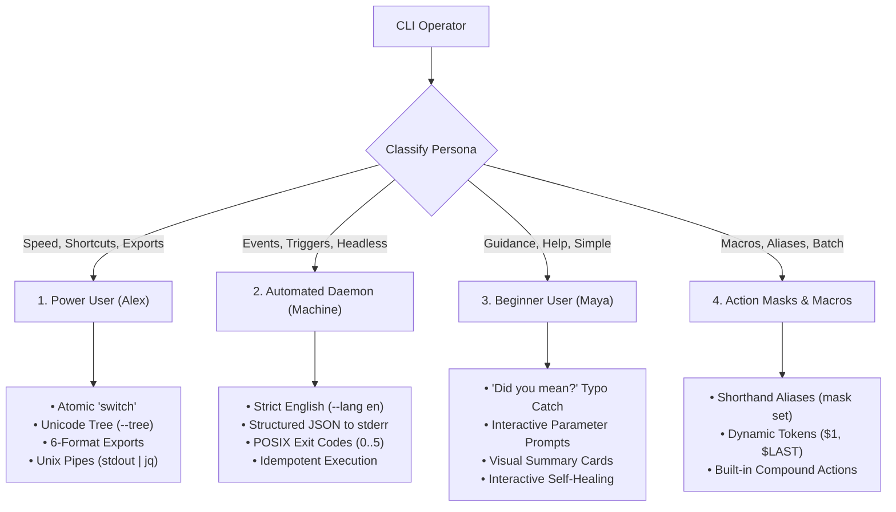

# CLI Architecture & Subsystem Specification

## oXyFlow — Native & Web Command-Line Interface

### 🎯 Vision

The oXyFlow CLI provides a high-velocity, deterministic, and scriptable interface to the time tracking engine. It is designed to serve both human operators (from keyboard-driven power users to terminal beginners) and automated headless daemons (CI/CD pipelines, Git hooks, cron schedulers).

The CLI is built around **strict architectural decoupling**: it lives as an isolated Rust module that directly consumes core domain contracts (`Engine`, `Persistence`), strictly isolated from the Tauri desktop GUI windowing runtime.

---

## 🏛 System Architecture & Modular Isolation

### Dual-Runtime Architectural Topology

```text
                  ┌───────────────────────────────────────────────┐
                  │                 ENTRY POINTS                  │
                  └───────┬───────────────────────────────┬───────┘
                          │                               │
        ┌─────────────────▼───────────────┐     ┌─────────▼─────────────────────┐
        │       Native Shell / CI         │     │     React Desktop / Web       │
        │   (Terminal / Bash / Cmd)       │     │   (CliInterface.tsx Shell)    │
        └─────────────────┬───────────────┘     └─────────┬─────────────────────┘
                          │                               │
                          ▼                               ▼
                 Native Rust CLI Module           TypeScript CliEngine
               (src-tauri/src/cli/*)           (src/features/cli/*)
                          │                               │
        ══════════════════╪═══════════════════════════════╪══════════════════  Module Boundary
                          │                               │
        ┌─────────────────▼───────────────┐     ┌─────────▼─────────────────────┐
        │      Engine & Persistence       │     │    Engine & Persistence       │
        │   (Rust Core Domain Engine)     │     │      (Browser Plugins)        │
        └─────────────────┬───────────────┘     └─────────┬─────────────────────┘
                          │                               │
                          ▼                               ▼
                   SQLite Database               Browser LocalStorage
                   & CSV/API Sinks                   & Web Sinks
```

### Module Isolation Invariants

1. **Zero Tauri GUI Coupling:** The Rust CLI module (`src-tauri/src/cli/`) must NEVER import `AppState`, `tauri::AppHandle`, `tauri::WebviewWindow`, `tauri::Manager`, or UI tray controllers. It must remain purely headless.
2. **Direct Domain Contract Invocation:** The CLI interacts with the application exclusively through:
   - `oxy_flow::engine::Engine` (timers, metrics calculation, temporal validation)
   - `oxy_flow::persistence::Persistence` (repositories: projects, tasks, subtasks, config, holidays, patches)
3. **Library & Workspace Decoupling Roadmap:** The CLI is structured so it can cleanly transition into a standalone crate/library:

   ```text
   Future Cargo Workspace:
   ├── crates/oxy-engine          # Core timer logic, validation, temporal algorithms (lib)
   ├── crates/oxy-persistence     # SQLite repositories, schema, migrations (lib)
   ├── crates/oxy-sinks           # CSV sink, webhook dispatcher, export serializers (lib)
   ├── crates/oxy-cli             # Command parser, formatters, interactive prompts (lib + bin)
   ├── crates/oxy-tray            # Desktop tray icon, native notifications (lib)
   └── src-tauri                  # Tauri wrapper, IPC commands, window orchestration (bin)
   ```

4. **Dual-Runtime Parity:** Every command, argument, flag, error code, and status output has a 1-to-1 parity contract between the Native Rust CLI binary and the In-App Web Terminal Emulator (`src/features/cli/`).

---

## 👥 The Four Persona Models



### 1. The Power User (Alex — Keyboard Maestro)

- **Primary Goal:** Sub-second time tracking without touching the mouse, terminal reports with Unicode trees, instant export for invoices/clients in HTML, JSON, XML, CSV, ODS, XLSX.
- **Key Commands:** `oxy switch <id>`, `oxy report --tree --week`, `oxy report export -f ods -o ./rep.ods`, `oxy report -f json | jq .`.

### 2. The Automated System / Daemon (Machine / CI / Git Hooks)

- **Primary Goal:** Headless event triggers, deterministic non-interactive execution, zero ambiguity.
- **Strict Invariant:** Always outputs in **English** (`en`), even if the user has configured Polish (`pl`), German (`de`), or Spanish (`es`) in the desktop GUI.
- **Key Commands:** `oxy timer start <id> --machine --json`, `oxy status --machine --json`.
- **Stream Discipline:** Clean data to `stdout`, structured JSON errors to `stderr`, non-zero POSIX exit codes (`1`..`5`).

### 3. The Beginner User (Maya — Junior Developer)

- **Primary Goal:** Zero frustration, welcoming feedback, clear daily summary, smart guidance when mistakes happen.
- **Features:** Fuzzy Levenshtein typo suggestion ("Did you mean?"), interactive prompts when parameters are omitted in TTY mode, friendly summary cards (`oxy summary`), interactive self-healing.

### 4. Action Masks & Macros (Productivity Supercharger)

- **Primary Goal:** Eliminate repetitive typing by binding custom aliases and parameterized command sequences.
- **Features:** `oxy mask set <name> "<template>"`, positional variable injection (`$1`, `$2`, `$LAST_TASK`), built-in compound actions (`switch`, `wrap-up`).

---

## 📋 Typical Actions Lifecycle Matrix

All commands follow the unified canonical hierarchy: `oxy <domain> <action> [args] [flags]`, with top-level shortcuts for primary daily tasks (`switch`, `summary`, `status`, `wrap-up`).

| Domain | Action | Command Syntax | Power User / Machine Flag | Beginner Interactive Behavior |
| :--- | :--- | :--- | :--- | :--- |
| **Project** | Create | `oxy project create "<name>" [-c <color>]` | `--machine --json` | Prompts for project name and color |
| **Project** | Archive | `oxy project archive <id>` | Soft-archives with `archived = true` | Displays confirmation with affected tasks |
| **Project** | List | `oxy project list` | Tabular or JSON output | Color-coded badges and active task counts |
| **Project** | Rename | `oxy project rename <id> "<new-name>"` | Updates entity and audit trail | Prompts for new name |
| **Task** | Create | `oxy task create -p <project-id> "<name>"` | Instant return with generated ID | Prompts to pick project and enter title |
| **Task** | Archive | `oxy task archive <id> -p <project-id>` | Soft-archives task and subtasks | Asks confirmation |
| **Task** | Complete | `oxy task complete <id>` | Toggles `completed: true` | Prints celebratory checkmark |
| **Task** | List | `oxy task list [-p <project-id>]` | Supports filtering and sorting | Hierarchical list with subtasks |
| **Subtask** | Create | `oxy subtask create -t <parent-id> "<name>"` | Links subtask to parent | Prompts for parent task selection |
| **Timer** | Start | `oxy timer start <task-id>` | Starts active log in SQLite | Displays green running timer badge |
| **Timer** | Stop | `oxy timer stop [--all]` | Idempotent timer stop | Prints total elapsed time for session |
| **Timer** | Switch | `oxy switch <new-task-id>` | Atomic stop old + start new ($<100\text{ms}$) | Explains previous and new task state |
| **Timer** | Quick-Log | `oxy timer log <task-id> <duration> ["<note>"]` | Direct retroactive log insertion | Confirms retroactive time captured |
| **Timer** | Status | `oxy status` | Single-line or JSON status | Visual card with live running timer |
| **Report** | Tree | `oxy report --tree [--today\|--week\|--month]` | Unicode box-drawing with bars | Easy-to-read hierarchy |
| **Report** | Summary | `oxy summary` | JSON in machine mode | Humanized daily card with praise |
| **Report** | Export | `oxy report export -f <format> -o <path>` | Supports **HTML, JSON, XML, CSV, ODS, XLSX** | Interactive format selector |
| **Report** | Stream | `oxy report -f json \| jq .` | Raw unescaped JSON to `stdout` | N/A (interactive terminal) |
| **Sink** | Set CSV | `oxy sink set csv --dir <path>` | Configures local CSV audit log | Prompts for directory path |
| **Sink** | Set API | `oxy sink set webhook --url <url> -t <token>` | Updates external webhook target | Tests connectivity and saves |
| **Sink** | Test | `oxy sink test` | Synthetic event verification | Displays green checkmarks for active sinks |
| **Mask** | Set | `oxy mask set <name> "<template>"` | Saves alias in SQLite `cli_aliases` | Validates syntax and explains variables |
| **Mask** | List | `oxy mask list` | Lists registered aliases | Displays examples of how to run them |

---

## 🛡️ Hierarchical Error & Failure Architecture

The CLI enforces a **Dual-Layer Response Architecture**:

```text
┌────────────────────────────────────────────────────────────────────────┐
│                        CLI RESPONSE ENVELOPE                           │
├────────────────────────────────────────────────────────────────────────┤
│  TECHNICAL LAYER (ALWAYS ENGLISH — GUARANTEED STABLE):                 │
│    • code: "DOM_ENTITY_NOT_FOUND"                                      │
│    • category: "Domain"                                                │
│    • message: "Task with ID '104' was not found in active project."    │
│    • exit_code: 1                                                      │
│    • timestamp: "2026-10-18T11:42:01.402Z"                             │
├────────────────────────────────────────────────────────────────────────┤
│  USER INFORMATION LAYER (CHOSEN LANGUAGE — e.g. POLISH 'pl'):          │
│    • locale: "pl"                                                      │
│    • title: "Nie znaleziono zadania"                                   │
│    • message: "Zadanie o numerze '104' nie istnieje w projekcie."      │
│    • suggestion: "Czy chodziło Ci o zadanie #105 'OAuth2 Auth'?"     │
│    • remediation: "Użyj 'oxy tasks core', aby wyświetlić listę zadań." │
│    • help_command: "oxy help task"                                     │
└────────────────────────────────────────────────────────────────────────┘
```

### Semantic Error Codes & Exit Statuses

| Category | Semantic Code | Exit Code | Description (Always English) |
| :--- | :--- | :--- | :--- |
| **Syntax** | `CLI_SYNTAX_UNKNOWN_CMD` | `2` | Unknown command verb or subcommand |
| **Syntax** | `CLI_SYNTAX_MISSING_ARG` | `2` | Required argument missing in non-interactive invocation |
| **Syntax** | `CLI_SYNTAX_INVALID_FLAG` | `2` | Flag not recognized for command |
| **Domain** | `DOM_ENTITY_NOT_FOUND` | `1` | Target project, task, or subtask ID not found |
| **Domain** | `DOM_ENTITY_ARCHIVED` | `1` | Action rejected because target entity is archived |
| **Domain** | `DOM_ENTITY_DUPLICATE_NAME` | `1` | Duplicate entity name in identical parent scope |
| **Engine** | `ENG_TIMER_ALREADY_ACTIVE` | `4` | Timer is already active on target task |
| **Engine** | `ENG_TIMER_NONE_ACTIVE` | `4` | `stop` called but no timers are active |
| **Engine** | `ENG_TIMER_OVERLAP_CONFLICT` | `4` | Retroactive log collides with existing time window |
| **Storage** | `STO_SQLITE_BUSY_LOCKED` | `3` | SQLite database file locked by another process |
| **Storage** | `STO_SQLITE_CORRUPT` | `3` | SQLite file failed integrity check |
| **Storage** | `STO_SQLITE_DISK_FULL` | `3` | Disk write failed due to lack of space |
| **Sinks** | `SNK_IO_DIR_NOT_WRITABLE` | `5` | CSV or report output path is not writable |
| **Sinks** | `SNK_EXPORT_UNSUPPORTED_FMT` | `2` | Requested export format is not supported |
| **Sinks** | `SNK_WEBHOOK_HTTP_FAILURE` | `5` | External API webhook returned HTTP 4xx or 5xx |
| **Sinks** | `SNK_WEBHOOK_TIMEOUT` | `5` | Webhook request timed out |
| **Masks** | `MSK_ALIAS_NOT_FOUND` | `2` | Specified action mask is not registered |
| **Masks** | `MSK_ALIAS_RECURSION_LOOP` | `2` | Action mask contains cyclic self-reference |
| **Masks** | `MSK_ALIAS_ARG_MISMATCH` | `2` | Mask expects parameters that were not provided |

### Interactive Self-Healing in TTY

In interactive human terminal mode, encountering `DOM_ENTITY_NOT_FOUND` or `CLI_SYNTAX_MISSING_ARG` does not abort the shell. Instead, the prompter:

1. Calculates Levenshtein distances ($\le 2$) against known entity names/commands.
2. Displays the nearest matches in the user's localized language.
3. Offers an interactive selector to pick the intended entity or create it on the spot.

---

## 🧪 Testing Architecture & Segregation

To maintain clean module boundaries and prevent regressions, test suites are strictly segregated:

```text
TimeLog/
├── src-tauri/tests/
│   ├── unit/
│   │   └── cli/                         # Rust CLI Unit Tests
│   │       ├── parser_test.rs           # Command-line syntax & flag parsing
│   │       ├── error_test.rs            # Technical English error envelopes & exit codes
│   │       ├── tree_renderer_test.rs    # Unicode tree formatting
│   │       └── mask_expansion_test.rs   # Macro alias parameter substitution
│   └── integration/
│       └── cli/                         # Rust CLI Integration Tests
│           ├── cli_lifecycle_test.rs    # Real SQLite execution of project/task/timer actions
│           ├── sinks_integration_test.rs# Real CSV emission & webhook mocking
│           └── export_formats_test.rs   # File format validation (HTML, XML, CSV, ODS, XLSX)
└── tests/
    ├── unit/
    │   └── cli/                         # TypeScript CliEngine Unit Tests
    │       ├── CliErrorFactory.test.ts  # Dual-layer envelope generation & i18n keys
    │       ├── FuzzyMatcher.test.ts     # Levenshtein distance typo tests
    │       └── InteractivePrompter.test.ts # Missing argument prompter
    └── integration/
        └── cli/                         # Cross-Runtime Parity Tests
            ├── cross_runtime_cli_parity.test.ts # Verifies identical syntax & JSON outputs
            └── cli_terminal_workflow.test.ts    # In-app terminal emulator lifecycle
```

---

## 🔗 Related Documentation

- [`MASTERMAP.md`](./MASTERMAP.md) — Product roadmap and phase tracking.
- [`ENGINEERING.md`](./ENGINEERING.md) — Architectural invariants and coding standards.
- [`USERINTERFACE.md`](./USERINTERFACE.md) — Spatial composition and design tokens.
- [`USEREXPERIENCE.md`](./USEREXPERIENCE.md) — UX workflows and feedback paradigms.
