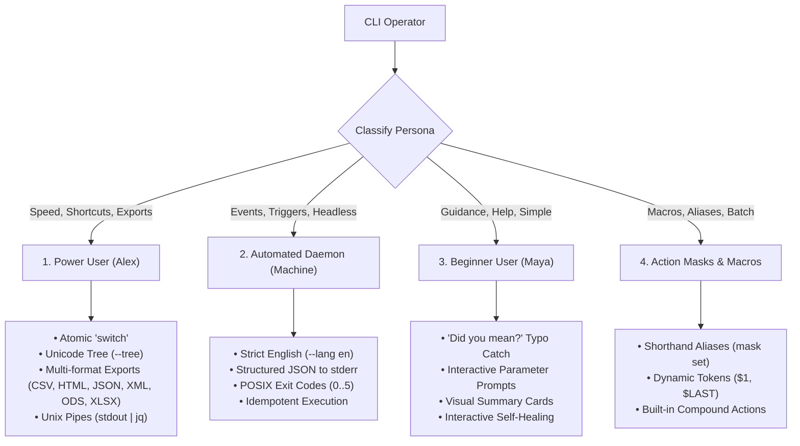

# CLI Architecture & Subsystem Specification

## oXyFlow — Native & Web Command-Line Interface

### 🎯 Vision

The oXyFlow CLI provides a high-velocity, deterministic, and scriptable interface to the time tracking engine. It is designed to serve both human operators (from keyboard-driven power users to terminal beginners) and automated headless daemons (CI/CD pipelines, Git hooks, cron schedulers).

The CLI is built around **strict architectural decoupling**: it lives as an isolated Rust module that directly consumes core domain contracts (`Engine`, `Persistence`), strictly isolated from the Tauri desktop GUI windowing runtime.

---

## 🏛 System Architecture & Modular Isolation

### Dual-Runtime Architectural Topology

```text
                  ┌───────────────────────────────────────────────┐
                  │                 ENTRY POINTS                  │
                  └───────┬───────────────────────────────┬───────┘
                          │                               │
        ┌─────────────────▼───────────────┐     ┌─────────▼─────────────────────┐
        │       Native Shell / CI         │     │     React Desktop / Web       │
        │   (Terminal / Bash / Cmd)       │     │   (CliInterface / CliDrawer)  │
        └─────────────────┬───────────────┘     └─────────┬─────────────────────┘
                          │                               │
                          │                               ▼
                          │                     CliRouter (IRouter<ICliClient>)
                          │                     (src/common/cli/CliRouter.ts)
                          │                               │
                          │            ┌──────────────────┴──────────────────┐
                          │            │ Desktop (TauriCliClient)            │ Browser (Sandbox)
                          │            │ [IPC: cli_execute]                  │
                          │            ▼                                     ▼
                          └──────────► Native Rust CLI Dispatcher    SandboxCommandRouter
                                      (src-tauri/src/cli/*)         (src/features/cli/sandbox/*)
                                               │                               │
        ═══════════════════════════════════════╪═══════════════════════════════╪═══════ Module Boundary
                                               │                               │
                                      ┌────────▼────────────┐         ┌────────▼────────────┐
                                      │ Engine & Repos      │         │ SandboxEmulatorStore│
                                      │ (Rust Core Domain)  │         │ (In-Memory State)   │
                                      └────────┬────────────┘         └─────────────────────┘
                                               │
                                               ▼
                                         SQLite Database
                                         & CSV/API Sinks
```

### Frontend CLI Routing & Runtime Integration

1. **Desktop Runtime (Tauri):** The in-app terminal delegates domain commands to the native Rust CLI via the `cli_execute` Tauri IPC command (`TauriCliClient`). The native binary parser (Clap) and domain dispatcher execute against SQLite, ensuring identical output formatting, validation, and error envelopes. After any mutating command, `DataContext.refreshData()` is triggered, synchronizing open GUI views instantaneously.
2. **Browser Runtime & Simulator:** In web environments without native IPC, or when sandbox mode is explicitly activated (`sandbox on`), commands route through `SandboxCommandRouter` and execute against `SandboxEmulatorStore` in memory, guaranteeing zero side-effects to storage.
3. **Shell Built-ins:** Interactive utility commands (`clear`, `sandbox [on|off|reset|status]`, `break [duration]`) are handled directly by the frontend shell orchestrator without reaching backend persistence.

### Module Isolation Invariants

1. **Zero Tauri GUI Coupling:** The Rust CLI module (`src-tauri/src/cli/`) must NEVER import `AppState`, `tauri::AppHandle`, `tauri::WebviewWindow`, `tauri::Manager`, or UI tray controllers. It must remain purely headless.
2. **Direct Domain Contract Invocation:** The CLI interacts with the application exclusively through:
   - `oxyflow_timelog::engine::Engine` (timers, metrics calculation, temporal validation)
   - `oxyflow_timelog::persistence::Persistence` (repositories: projects, tasks, subtasks, config, holidays, patches)
3. **Library & Workspace Decoupling Roadmap:** The CLI is structured so it can cleanly transition into a standalone crate/library:

   ```text
   Future Cargo Workspace:
   ├── crates/oxy-engine          # Core timer logic, validation, temporal algorithms (lib)
   ├── crates/oxy-persistence     # SQLite repositories, schema, migrations (lib)
   ├── crates/oxy-sinks           # CSV sink, webhook dispatcher, export serializers (lib)
   ├── crates/oxy-cli             # Command parser, formatters, interactive prompts (lib + bin)
   ├── crates/oxy-tray            # Desktop tray icon, native notifications (lib)
   └── src-tauri                  # Tauri wrapper, IPC commands, window orchestration (bin)
   ```

4. **Dual-Runtime Parity:** Every command, argument, flag, error code, and status output has a 1-to-1 parity contract between the Native Rust CLI binary and the In-App Web Terminal Emulator (`src/features/cli/`).

---

## 👥 The Four Persona Models



### 1. The Power User (Alex — Keyboard Maestro)

- **Primary Goal:** Sub-second time tracking without touching the mouse, terminal reports with Unicode trees, instant export for invoices/clients across all standard formats (CSV, HTML, JSON, XML, ODS, XLSX).
- **Key Commands:** `oxy switch <id>`, `oxy report --tree --week`, `oxy report export -f html -o ./rep.html`, `oxy report -f json | jq .`.

### 2. The Automated System / Daemon (Machine / CI / Git Hooks)

- **Primary Goal:** Headless event triggers, deterministic non-interactive execution, zero ambiguity.
- **Strict Invariant:** Always outputs in **English** (`en`) by default, even if the user has configured Polish (`pl`), German (`de`), or Spanish (`es`) in the desktop GUI. Machine locale can be explicitly configured via `cli_machine_locale`.
- **Default Locale Semantics:** `en` is the active, effective default. If `cli_machine_locale` is absent from SQLite, `oxy config get cli_machine_locale` returns `en`. `oxy config ls` lists only physically persisted database keys, meaning absence in `config ls` does not indicate an unconfigured or broken locale.
- **Key Commands:** `oxy timer start <id> --machine --json`, `oxy status --machine --json`, `oxy config get cli_machine_locale`.
- **Stream Discipline:** Clean machine data exclusively to `stdout`, structured JSON error envelopes and diagnostic logs (`env_logger`) strictly to `stderr`, non-zero POSIX exit codes (`1`..`5`). Logs never pollute `stdout`.

### 3. The Beginner User (Maya — Junior Developer)

- **Primary Goal:** Zero frustration, welcoming feedback, clear daily summary, smart guidance when mistakes happen.
- **Features:** Fuzzy Levenshtein typo suggestion ("Did you mean?"), interactive prompts when parameters are omitted in TTY mode, friendly summary cards (`oxy summary`), interactive self-healing.

### 4. Action Masks & Macros (Productivity Supercharger)

- **Primary Goal:** Eliminate repetitive typing by binding custom aliases and parameterized command sequences.
- **Features:** `oxy mask set <name> "<template>"`, positional variable injection (`$1`, `$2`, `$LAST_TASK`), built-in compound actions (`switch`, `wrap-up`).

---

## 📋 Typical Actions Lifecycle Matrix

All commands follow the unified canonical hierarchy: `oxy <domain> <action> [args] [flags]`, with top-level shortcuts for primary daily tasks (`start`, `stop`, `switch`, `status`, `today` / `summary`). The `wrap-up` compound action is planned.

> The matrix below describes the target command design. The authoritative list of implemented commands and flags is the clap parser in `src-tauri/src/cli/parser/` (`oxy --help`).

| Domain | Action | Command Syntax | Power User / Machine Flag | Beginner Interactive Behavior |
| :--- | :--- | :--- | :--- | :--- |
| **Project** | Create | `oxy project add "<name>" [--rate <amount>] [--rate-cents <cents>] [--currency <CODE>]` | `--machine --json` | Prompts for project name and color |
| **Project** | Archive | `oxy project archive <id>` | Soft-archives with `archived = true` | Displays confirmation with affected tasks |
| **Project** | List | `oxy project list` | Tabular or JSON output | Color-coded badges and active task counts |
| **Project** | Rename / update | `oxy project rename <id> [<new-name>] [--rate <amount>] [--rate-cents <cents>] [--currency <CODE>]` | Updates entity and billing configuration | Prompts for new name |
| **Task** | Create | `oxy task add -p <project-id> "<name>" [--rate <amount>] [--rate-cents <cents>]` | Instant return with generated ID | Prompts to pick project and enter title |
| **Task** | Archive | `oxy task archive <id> -p <project-id>` | Soft-archives task and subtasks | Asks confirmation |
| **Task** | Complete | `oxy task complete <id>` | Toggles `completed: true` | Prints celebratory checkmark |
| **Task** | List | `oxy task list [-p <project-id>]` | Supports filtering and sorting | Hierarchical list with subtasks |
| **Task** | Billing rate | `oxy task rate <id> <amount\|inherit\|none> [--currency <CODE>] [--cents]` | Sets override, clears it to inherit, or applies currency override | N/A (explicit arguments) |
| **Subtask** | Create | `oxy subtask create -t <parent-id> "<name>"` | Links subtask to parent | Prompts for parent task selection |
| **Timer** | Start | `oxy timer start <task-id>` | Starts active log in SQLite; starting an already running task is a no-op (`alreadyRunning`), and tasks stopped as a side effect are reported (`stoppedTaskIds`) | Displays green running timer badge |
| **Timer** | Stop | `oxy timer stop [--all] [--if-running]` | Stops the active timer; fails with `ENG_TIMER_INACTIVE` (exit 5) when nothing is running. `--if-running` succeeds as a no-op instead; `--all` stops all active timers | Prints total elapsed time for session |
| **Timer** | Switch | `oxy switch <new-task-id>` | Atomic stop old + start new ($<100\text{ms}$) | Explains previous and new task state |
| **Timer** | Quick-Log | `oxy timer log <task-id> <duration> ["<note>"]` | Direct retroactive log insertion | Confirms retroactive time captured |
| **Timer** | Status | `oxy status` | Single-line or JSON status | Visual card with live running timer |
| **Log** | Add | `oxy log add <target> [<duration>] ["<note>"] [--from <iso>] [--to <iso>]` | Direct retroactive log insertion | Confirms retroactive time captured |
| **Log** | Edit | `oxy log edit <id> [--duration <dur>] [--note <note>] [--start <iso>] [--end <iso>] [--task <target>] --reason <text>` | Updates time log with required audit reason (`--reason <text>` or `-r <text>`) | Prompts for edit fields and audit reason |
| **Log** | List | `oxy log list [-p <proj>] [-t <task>] [--today\|--yesterday\|--week\|--last-week\|--month\|--last-month] [--from <iso>] [--to <iso>] [--tz <iana>] [--limit <n>]` | Filtered tabular or JSON list (no default limit in machine mode) | Displays filtered log entries (default 20 + footer in human mode) |
| **Log** | Remove | `oxy log rm <id> [--yes\|-y]` | Deletes time log entry; returns deleted entry in JSON mode | In interactive TTY, prompts confirmation (`Remove entry <short id> (45m, <task name>)? [y/N]`) unless `--yes`/`-y` or machine mode |
| **Report** | Tree | `oxy report --tree [--today\|--yesterday\|--week\|--last-week\|--month\|--last-month] [--tz <iana>]` | Unicode box-drawing with bars | Easy-to-read hierarchy |
| **Report** | Range | `oxy report [--from <YYYY-MM-DD>] [--to <YYYY-MM-DD>] [--tz <iana>] [-p <proj>] [-t <task>]` | Filtered date range reporting | Validates ISO date formats |
| **Report** | Summary | `oxy summary` | JSON in machine mode | Humanized daily card with praise |
| **Report** | Export | `oxy report export -f <format> -o <path>` | Fully supports **CSV, HTML, JSON, XML, ODS, XLSX**; serialization errors yield `SNK_SERIALIZATION` (exit code `1`) | Interactive format selector |
| **Report** | Schema | `oxy report schema [--format json\|xml] [--target report\|envelope] [-o <path>]` | Emits the generated JSON Schema (draft 2020-12) of `oxy.report` v2 (default), the JSON Schema of the machine envelope (`--target envelope`), or the XSD of `report export -f xml` (`--format xml`) to stdout or file; `--format xml --target envelope` is a syntax error (exit code `2`) | Download schema |
| **Report** | Stream | `oxy report -f json \| jq .` | Raw unescaped JSON to `stdout` | N/A (interactive terminal) |
| **Doctor** | Diagnostics | `oxy doctor` | Emits diagnostic health report (`--json` envelope) | Tests DB access, integrity, schema, sinks |
| **Database** | Backup | `oxy db backup <path>` | Lock-free SQLite snapshot via Online Backup API | Reports created backup file |
| **Database** | Restore | `oxy db restore <path>` | Restores state with schema integrity verification | Confirms restored database |
| **Config** | Set | `oxy config set <key> <val>` | Sets SQLite config entry (e.g. `cli_machine_locale`) | Validates supported keys and values |
| **Config** | Get | `oxy config get <key>` | Gets effective config value (defaults to `en` for `cli_machine_locale`) | Displays active configuration value |
| **Config** | List | `oxy config ls` | Lists physically persisted SQLite configuration entries | Displays table of saved config pairs |
| **Sink** | Set CSV | `oxy sink set csv --dir <path>` | Configures local CSV audit log | Prompts for directory path |
| **Sink** | Set API | `oxy sink set webhook --url <url> -t <token>` | Updates external webhook target | Tests connectivity and saves |
| **Sink** | Test | `oxy sink test` | Synthetic event verification | Displays green checkmarks for active sinks |
| **Mask** | Set | `oxy mask set <name> "<template>"` | Saves alias in SQLite `cli_aliases` | Validates syntax and explains variables |
| **Mask** | List | `oxy mask list` | Lists registered aliases | Displays examples of how to run them |
| **Mask** | Execute | `oxy <mask-name> [args]` | Preprocessed substitution of `$1..$9` tokens | Seamless alias execution |

---

### Period Flags & Timezone (Implemented)

`log list`, `report` (including `report tree` and `report export`) accept the same period flags. `today` and the bare `oxy` dashboard accept `--tz` only; their period is always the current local day.

| Flag | Meaning |
| --- | --- |
| `--today`, `--yesterday` | Local calendar day |
| `--week`, `--last-week` | Local calendar week, **Monday through Sunday** |
| `--month`, `--last-month` | Local calendar month |
| `--from <v>`, `--to <v>` | Custom bounds: `YYYY-MM-DD`, `YYYY-MM-DD HH:MM:SS` or RFC3339 |
| `--tz <IANA>` | Timezone used for every boundary above (global flag, e.g. `Europe/Warsaw`) |

- **Exclusivity:** the six presets are mutually exclusive with each other and with `--from`/`--to`. Any combination is a syntax error (`CLI_SYNTAX_INVALID_ARGS`, exit `2`; in machine mode a JSON envelope on stderr).
- **Half-open range:** every resolved range is `[from, to)` in UTC. `to` is **exclusive**: a log starting exactly at `to` is not included. A date-only `--to 2026-10-31` means up to the start of `2026-11-01` in the chosen timezone, so the whole day is covered.
- **Default period:** with no preset and no bounds, `log list` and `report` cover all time.
- **Timezone resolution:** `--tz` wins over the application's timezone setting; `System` or an unset value uses the OS zone, falling back to UTC when it cannot be detected. An unknown zone name (`--tz Mars/Olympus`) or an inverted range (`--from` later than `--to`) is a syntax error (exit `2`).
- **Single source of truth:** all boundaries come from `Engine::resolve_range`; the in-app sandbox emulator uses the browser mirror (`resolveRangeAt`) and behaves identically. `oxy log list --week` therefore no longer means "the last 7 days".

### Quiet Output for Scripts (Implemented)

`-q` / `--quiet` is a global flag with one contract in the native `oxy` binary and the browser sandbox emulator. It shapes successful output only; `--machine` / `--json` take precedence when both are given.

- **Mutations** (`project add|rename|archive`, `task add|done|rename|rate|reparent|move|archive`, `log add|edit|remove`) print the affected entity's full ID followed by a newline and nothing else.
- **Lists** (`project ls`, `task ls`, `log ls`) print one row per entity, with no header, footer, or status prefix. An empty list prints no rows.
- **Errors are never suppressed.** They still go to `stderr` with the same exit codes as the verbose run.

```bash
TASK_ID=$(oxy task add "Code review" -p "Core" -q)
oxy project ls -q | grep -c "Core"
```

- **Flow commands** (`start`, `switch`) print the ID of the time log they open. Starting a task that is already running opens no log, so `start -q` prints nothing in that case (exit code 0).

Not yet covered by this contract: `report` (planned follow-up). Its quiet output is unchanged.

### Machine Output Envelope (Implemented for flow, entity and subsystem commands)

Every successful `--json` / `--machine` response of a migrated command is one versioned envelope on `stdout`. The contract is identical in the native `oxy` binary and the browser sandbox emulator, and the TypeScript shape is generated into `src/bindings/SuccessEnvelope.ts`.

```json
{
  "schema": "oxy.status",
  "schemaVersion": 1,
  "data": { "activeTaskIds": ["task-42"], "count": 1, "running": true },
  "meta": {
    "generatedAt": "2026-11-12T10:30:15Z",
    "generator": { "name": "oxy", "version": "1.14.5" }
  }
}
```

- `schema` is `oxy.<command>` (flow commands and `doctor`) or `oxy.<domain>.<action>` (entity and subsystem commands); `schemaVersion` is an integer bumped on any breaking change to that schema's `data` shape. There is no compatibility mode for earlier shapes: consumers pin on `schema` + `schemaVersion`.
- `meta.generatedAt` is whole-second RFC 3339 UTC; `meta.generator` is the same `{ name, version }` pair that `oxy.report` carries.
- All JSON keys are camelCase at every depth. Enum values (`action`) are camelCase too.
- **Formatting:** `--machine` always prints one compact line. `--json` prints indented JSON only when `stdout` is a terminal and `--machine` is absent; piped or redirected `--json` output is one compact line. The sandbox has no terminal and always prints the compact line.
- Errors are not part of this envelope; they keep the existing `stderr` error envelope and exit codes.
- Commands that are not listed in the table below still print their previous raw JSON and migrate in later changes.

| Command | `schema` | `schemaVersion` | `data` |
| --- | --- | --- | --- |
| `oxy start <task>` | `oxy.start` | 1 | `{ action: "started" \| "alreadyRunning", taskId, timeLogId: string \| null, stoppedTaskIds: string[] }`; `timeLogId` is `null` when the task was already running |
| `oxy start` (no target, timer running) | `oxy.status` | 1 | the `oxy.status` payload, because the command only reports the running timers |
| `oxy stop` | `oxy.stop` | 1 | `{ action: "stopped" \| "noop", stoppedCount }`; `noop` only for `--if-running` on an idle timer |
| `oxy switch <task>` | `oxy.switch` | 1 | `{ action: "switched", taskId, timeLogId }` |
| `oxy status` | `oxy.status` | 1 | `{ activeTaskIds: string[], count, running }` |
| `oxy project ls` | `oxy.project.list` | 1 | `{ items: Project[] }` |
| `oxy project add <name>` | `oxy.project.add` | 1 | `Project` entity object |
| `oxy project rename <target>` | `oxy.project.rename` | 1 | `Project` entity object |
| `oxy project archive <target>` | `oxy.project.archive` | 1 | `{ id: string, action: "archived" }` |
| `oxy task ls` | `oxy.task.list` | 1 | `{ items: Task[] }` |
| `oxy task add <name> -p <proj>` | `oxy.task.add` | 1 | `Task` entity object |
| `oxy task done <target>` | `oxy.task.done` | 1 | `Task` entity object |
| `oxy task rename <target> <name>` | `oxy.task.rename` | 1 | `Task` entity object |
| `oxy task rate <target> <rate>` | `oxy.task.rate` | 1 | `Task` entity object |
| `oxy task reparent <target> <parent>` | `oxy.task.reparent` | 1 | `Task` entity object |
| `oxy task move <target> <proj>` | `oxy.task.move` | 1 | `Task` entity object |
| `oxy task archive <target>` | `oxy.task.archive` | 1 | `{ id: string, action: "archived" }` |
| `oxy log ls` | `oxy.log.list` | 1 | `{ items: TimeLog[], totalMatched: number }` |
| `oxy log add <target> [dur]` | `oxy.log.add` | 1 | `TimeLog` entity object |
| `oxy log edit <id> --reason <r>` | `oxy.log.edit` | 1 | `TimeLog` entity object |
| `oxy log rm <id>` | `oxy.log.remove` | 1 | `{ id: string, action: "removed", entry: TimeLog }` |
| `oxy config ls` | `oxy.config.list` | 1 | `{ items: { key, value }[] }`; lists only keys persisted in SQLite, so an unset `cli_machine_locale` is absent |
| `oxy config get <key>` | `oxy.config.get` | 1 | `{ key, value }`; `cli_machine_locale` returns its effective default `en` when unset |
| `oxy config set <key> <value>` | `oxy.config.set` | 1 | `{ key, value }` with the normalized value |
| `oxy sink ls` | `oxy.sink.list` | 1 | `{ items: { name, sinkType, target, hasToken, enabled, createdAt }[] }`; the webhook token itself is never printed, only whether one is stored (`hasToken`) |
| `oxy sink set-csv` / `oxy sink set-webhook` | `oxy.sink.set` | 1 | `{ sinkType: "csv" \| "webhook", target }` |
| `oxy sink test` | `oxy.sink.test` | 1 | `{ items: { name, sinkType, target, passed, detail }[] }`; a failing sink makes the command fail instead |
| `oxy mask ls` | `oxy.mask.list` | 1 | `{ items: { name, template, createdAt }[] }` |
| `oxy mask set <name> <template>` | `oxy.mask.set` | 1 | `{ name, template }` |
| `oxy mask rm <name>` | `oxy.mask.remove` | 1 | `{ name }` |
| `oxy doctor` | `oxy.doctor` | 1 | `{ overallStatus: "ok", dbPath, dbSizeBytes, checks: { name, status, message }[] }`; emitted only when every check passes, otherwise the command fails as before |
| `oxy db backup <path>` | `oxy.db.backup` | 1 | `{ destination }` |
| `oxy db restore <path>` | `oxy.db.restore` | 1 | `{ source }` |

The former `"status": "ok"` field is gone: a successful exit code and the envelope itself signal success. Not migrated yet: `oxy today` and `oxy` (dashboard), which keep their snake_case keys (planned with the richer `status` / `today` payloads), and `oxy report --json` / `oxy report schema -o --machine`, which keep their previous shapes until the report output moves to `ReportDocument`.

### Billing Configuration (Implemented)

Billing rates are configured on Projects and optionally overridden on Tasks. The native CLI accepts a rate in major currency units (for example, `150.00`) or as integer minor units (for example, `15000` cents). A Project currency is supplied as a three-letter code such as `PLN`, `EUR`, or `USD`.

**Create or update a Project rate**

```bash
# Create a project with a rate of 150.00 PLN per hour
oxy project add "Client Work" --rate "150.00" --currency PLN

# Update an existing project's rate and currency
oxy project rename "Client Work" --rate "175.50" --currency EUR

# Clear the project's rate or currency
oxy project rename "Client Work" --rate none --currency none
```

**Set a Task override or inherit the Project rate**

```bash
# Create a task with a custom hourly rate
oxy task add "Implementation" --project "Client Work" --rate "200.00"

# Set a custom rate and currency override on an existing task
oxy task rate "Implementation" "220.00" --currency PLN

# Set an explicit zero rate (non-billable)
oxy task rate "Implementation" "0.00"

# Remove the Task override and inherit the Project rate again
oxy task rate "Implementation" inherit
```

For integer minor-unit input, use `--rate-cents 15000` on Project/Task creation or Project update, or use `--cents` with `oxy task rate <target> 15000 --cents`. Do not pass both `--rate` and `--rate-cents` in one command. Task rate values `inherit`, `none`, and `clear` remove the Task override; an explicit `0.00` remains a non-billable override.

**Current CLI scope:** Project/Task billing configuration and machine-readable mutation responses are implemented. Billing-aware CLI report output is not implemented yet; `oxy report` continues to use the existing elapsed-time report path. Billing summaries are currently available in the application's Reports view.

**Rate input contract:** Rates have two decimal places and are represented internally as integer cents. The accepted maximum is 9,007,199,254,740,991 cents (the JavaScript safe-integer boundary), and larger values are rejected consistently by Rust and TypeScript. The report calculator rounds each task's calculated amount to the currency's two-decimal minor-unit representation using round-half-to-even (banker's rounding).

---

### Report Export Subsystem (Implemented)

**Report figures:** `oxy report` (tree, `--json` and every export) computes its numbers with the engine's canonical report builder (`Engine::build_report`, see [`ENGINEERING.md`](./ENGINEERING.md#canonical-report-model-reportdocument)) and maps the result to the established output shapes. In those shapes, `entries` are ordered by start time and then ID, each entry's `date` is the local calendar date (in the report timezone) of the part of the entry that falls inside the range, and `start_time` / `end_time` show the in-range part as whole-second RFC 3339 instants. `oxy report --json` keeps this legacy shape until it switches to the `ReportDocument` (`oxy.report` v2) contract.

The CLI provides deterministic report exports across six structured formats via `oxy report export -f <format> -o <path>`:

- **Tabular & Structured Text Formats:**
  - `csv`: Comma-separated values adhering to RFC 4180 with standard UTF-8 encoding.
  - `html`: Self-contained, responsive HTML document with embedded CSS styling and semantic tables.
  - `json`: Structured JSON payload with comprehensive summary metrics, project aggregates, and detailed task breakdowns.
  - `xml`: Sanitized hierarchical XML with ISO 8601 timestamps and strictly escaped entity values.
- **Spreadsheet Archive Packages (ZIP-based):**
  - `ods`: OpenDocument Spreadsheet 1.3 package generated natively in Rust using `spreadsheet-ods`.
  - `xlsx`: Office Open XML SpreadsheetML workbook generated natively in Rust using `rust_xlsxwriter`.

**Memory Buffering and File Output Architecture:**
In the current implementation, all CLI report exporters serialize content into memory before writing to target storage:
- Formats `csv`, `html`, `json`, and `xml` are serialized in memory as UTF-8 payload strings and written to disk using `std::fs::write`.
- Formats `ods` and `xlsx` are generated natively in Rust using `spreadsheet-ods` and `rust_xlsxwriter` into byte buffers (`Vec<u8>`) and written via `std::fs::write`.
- The dedicated ZIP32 builder with MS-DOS timestamps and 32-bit boundary validation operates exclusively within the TypeScript browser plugin layer (`src/plugins/exporters/zipBuilder.ts`), rather than the Rust CLI runtime.
- Direct streaming to disk without intermediary in-memory buffering is marked as `[PLANNED]` pending completion of task B3.

**Schema Publication (`oxy report schema`):**
The CLI publishes the JSON Schema (draft 2020-12) of the report document. The schema is generated from the Rust types with `schemars`, so it cannot drift from the `oxy.report` model that the engine builds and `src/bindings/ReportDocument.ts` mirrors.
- `oxy report schema` (same as `--format json --target report`): Prints the schema of `oxy.report` `schemaVersion` 2 to `stdout`. The schema's `$id` is `urn:oxyflow:schema:oxy.report:2` and its `title` is `oxy.report`; `schema` and `schemaVersion` are pinned with `const`.
- `oxy report schema --target envelope`: Prints the schema of the versioned machine envelope (`$id` `urn:oxyflow:schema:oxy.envelope:1`). The envelope's `data` is intentionally unconstrained; each command's `schema` / `schemaVersion` pair identifies its payload.
- `oxy report schema -o <path>` (or `--output <path>`): Writes the schema to the file instead of `stdout`. Parent directories are created automatically. With `--machine`, `stdout` carries `{ "status": "success", "exported_path", "schema", "schema_version" }` instead of the human message.
- `stdout` is always exactly one JSON document, with and without `--machine`. The output is deterministic (properties are sorted alphabetically), so it can be diffed and pinned.
- Optional properties (`skip_serializing_if`) are absent from `required` and do not accept `null`; unsigned integers are `integer` with `minimum: 0`.
- The committed copies live in `schemas/json/report/v2/report.schema.json` and `schemas/json/envelope/v1/envelope.schema.json`; an integration test fails when they differ from the generated output. After an intentional contract change run `cargo test --test integration_tests regenerate_json_schemas -- --ignored` and review the diff.
- `oxy report schema --format xml` prints the canonical XML Schema (XSD, version `1`) that describes the document written by `oxy report export -f xml`. It is not the `oxy.report` v2 model: an XSD for `oxy.report` v2 ships together with the XML exporter that emits it. With `-o`, the success message names `XML` and version `1`, and with `--machine` the summary has the same shape as for JSON (`schema` is `"XML"`, `schema_version` is `1`).
- `--format xml --target envelope` fails with `CLI_SYNTAX_INVALID_ARGS` (exit code `2`) and writes nothing: the envelope schema is only available as JSON.
- The former `--version <v>` flag is removed: only XSD version `1` exists, and the JSON schema version is part of its identity (`$id`).

**Error Classification & Exit Codes:**
If an export cannot be formatted, encoded, or serialized, the CLI emits a structured error envelope with semantic code `SNK_SERIALIZATION` and POSIX exit code `1` (business/sink rule violation). If file I/O fails during target file creation or writing, the CLI emits `SNK_EXTERNAL_IO` with exit code `1`.

---
## 🛡️ Hierarchical Error & Failure Architecture

The CLI enforces a **Dual-Layer Response Architecture**:

```text
┌────────────────────────────────────────────────────────────────────────┐
│                        CLI RESPONSE ENVELOPE                           │
├────────────────────────────────────────────────────────────────────────┤
│  TECHNICAL LAYER (ALWAYS ENGLISH — GUARANTEED STABLE):                 │
│    • code: "DOM_ENTITY_NOT_FOUND"                                      │
│    • category: "entity"                                                │
│    • technical: "Task with ID '104' was not found in active project."  │
│    • exit_code: 4                                                      │
│    • timestamp: "2026-10-18T11:42:01.402Z"                             │
├────────────────────────────────────────────────────────────────────────┤
│  STRUCTURED DETAILS (OPTIONAL, OMITTED WHEN EMPTY):                    │
│    • candidates: [{ id: "...", name: "..." }]                          │
│    • suggestion: { id: "...", name: "..." }                            │
│    • field: "--format"                                                 │
│    • value: "yaml"                                                     │
├────────────────────────────────────────────────────────────────────────┤
│  USER INFORMATION LAYER (CHOSEN LANGUAGE — e.g. POLISH 'pl'):          │
│    • locale: "pl"                                                      │
│    • message: "Zadanie o numerze '104' nie istnieje w projekcie."      │
│    • suggestion: "Czy chodziło Ci o zadanie #105 'OAuth2 Auth'?"       │
│    • remediation: "Użyj 'oxy task list', aby wyświetlić listę zadań."  │
└────────────────────────────────────────────────────────────────────────┘
```

The envelope is `CliErrorEnvelope` in `src-tauri/src/cli/error/envelope.rs`; the user layer (`LocalizedUserMessage`) is optional and omitted in `--machine` mode. In machine mode parser errors are also returned as the JSON envelope (`CLI_SYNTAX_UNKNOWN_COMMAND` / `CLI_SYNTAX_INVALID_ARGS`, exit 2); help and version output are unaffected.

When available, structured error context is exposed via the optional `details` object (`CliErrorDetails`):
- `details.candidates`: array of `{ id: string, name: string }` objects representing matched candidates on ambiguous entity queries (`DOM_ENTITY_AMBIGUOUS`).
- `details.suggestion`: single `{ id: string, name: string }` object with the closest entity candidate when a typo was made (`DOM_ENTITY_DID_YOU_MEAN`).
- `details.field`: offending CLI argument/flag name (e.g. `--format`) on parser validation errors (`CLI_SYNTAX_INVALID_ARGS`).
- `details.value`: invalid input value passed to the argument (e.g. `yaml`).

All members of `details` are camelCase and omitted when absent (`skip_serializing_if`). The `details` field itself is completely omitted from the JSON envelope when empty.

### Exit Codes

Defined in `src-tauri/src/cli/shared/constants.rs` and mapped by `CliError::exit_code()`:

| Exit Code | Meaning |
| :--- | :--- |
| `0` | Success |
| `1` | Business rule violation |
| `2` | Invalid syntax or arguments |
| `3` | Storage (SQLite) failure |
| `4` | Entity not found, ambiguous or did-you-mean |
| `5` | Engine / timer lifecycle conflict |

### Semantic Error Codes

Defined in `src-tauri/src/cli/error/codes.rs`. Codes marked *not yet emitted* exist in the enum but no code path produces them yet.

| Category | Semantic Code | Exit Code | Description |
| :--- | :--- | :--- | :--- |
| `syntax` | `CLI_SYNTAX_INVALID_ARGS` | `2` | Invalid arguments |
| `syntax` | `CLI_SYNTAX_INVALID_DURATION` | `2` | Duration could not be parsed |
| `syntax` | `CLI_SYNTAX_EMPTY_ID` | `2` | Empty entity ID |
| `syntax` | `CLI_SYNTAX_MISSING_TARGET` | `2` | Required target missing |
| `syntax` | `CLI_SYNTAX_UNKNOWN_COMMAND` | `2` | Unknown command |
| `entity` | `DOM_ENTITY_NOT_FOUND` | `4` | Target project, task or subtask not found |
| `entity` | `DOM_ENTITY_AMBIGUOUS` | `4` | Query matches more than one entity |
| `entity` | `DOM_ENTITY_DID_YOU_MEAN` | `4` | No exact match; close matches suggested |
| `storage` | `STO_SQLITE_INIT` | `3` | Database initialization failed |
| `storage` | `STO_SQLITE_QUERY` | `3` | Query failed |
| `storage` | `STO_SQLITE_CONSTRAINT` | `3` | Constraint violation |
| `engine` | `ENG_TIMER_CONFLICT` | `5` | Active timer conflict |
| `engine` | `ENG_TIMER_ACTIVE` | `5` | Timer already active (*not yet emitted*) |
| `engine` | `ENG_TIMER_INACTIVE` | `5` | No active timer running |
| `engine` | `ENG_OPERATION_FAILED` | `1` | Engine internal operation failed |
| `business` | `DOM_BUSINESS_VIOLATION` | `1` | Business rule violated (e.g. starting/switching timer on completed task) |
| `business` | `DOM_BUSINESS_NO_PROJECTS` | `1` | Operation requires at least one project |
| `sink` | `SNK_EXTERNAL_IO` | `1` | Sink I/O or verification failure |
| `sink` | `SNK_SERIALIZATION` | `1` | Sink export serialization failure |
| `mask` | `MSK_ALIAS_NOT_FOUND` | `2` | Action mask alias not found |
| `mask` | `MSK_ALIAS_SYNTAX` | `2` | Invalid mask syntax |

`--db` must point to an existing file. A missing file fails with `STO_SQLITE_INIT` (exit 3) before anything is created. Only `db restore` may create the target. Without `--db`, the default database is created on first run.

### Interactive Self-Healing in TTY

In interactive human terminal mode, encountering an unknown entity or a missing required argument does not abort the shell. Instead, the prompter:

1. Calculates Levenshtein distances ($\le 2$) against known entity names/commands.
2. Displays the nearest matches in the user's localized language.
3. Offers an interactive selector to pick the intended entity or create it on the spot.

In `--json`/`--machine` mode, or in human mode with the global `--exact` flag, `-p`/`-t` and other targets resolve only by exact ID, unique ID prefix of ≥ 8 characters, or exact name (case-insensitive); fuzzy matching, substring matching, prefixes < 8 characters, and suggestions are human-mode only (without `--exact`).

### Log Removal Confirmation (`oxy log rm`)

`oxy log rm <id>` asks for confirmation before deleting:
- **Interactive TTY:** Prompts `Remove entry <short id> (<duration>, <task name>)? [y/N]`. Anything but `y` or `yes` (case-insensitive) cancels the operation, deletes nothing, prints `Operation cancelled.`, and exits with code 0.
- **Bypass Prompting:** In non-interactive pipelines (non-TTY stdin / pipes), when the `--yes` (`-y`) flag is provided, or in machine mode (`--json` / `--machine`), removal proceeds immediately without asking.
- **Machine Envelope:** In `--json` / `--machine` mode the command prints the `oxy.log.remove` envelope whose `data` is `{ id, action: "removed", entry }`; `entry` is the removed time log, enabling recreation via `oxy log add`.
- **Quiet mode:** `oxy log rm <id> -q` prints only the removed ID.

---

## 🪟 In-App Global CLI Drawer & Session Synchronization

### 1. CliDrawer Architecture (``Ctrl+` `` / `Esc`)

The in-app CLI is accessible everywhere across all application layouts (Compact, Medium, Full) via the global `CliDrawer` component (`src/features/cli/CliDrawer.tsx`):

- **Slide-Down Presentation**: Animated top sheet (`motion.div`) with polymorphic design tokens (`bg-card/95`, `backdrop-blur-xl`, `border-border`, `text-foreground`).
- **Global Keybinding**: Toggled instantaneously via ``Ctrl+` `` (`Backquote`), registered via `useGlobalShortcuts`.
- **Keyboard Trapping & Dismissal**: Automatically closes on `Escape` or clicking the backdrop overlay/close button, restoring focus to the primary UI.
- **Responsive Layout Adaptation**: When toggled in `CompactLayout`, `CliSessionProvider` automatically expands the window into `MediumLayout` so the terminal console has sufficient viewport space without clipping.

### 2. CliSessionContext & State Synchronization

Terminal history, execution state, and command buffers are orchestrated by `CliSessionContext` (`src/features/cli/context/CliSessionContext.ts` and `CliSessionProvider.tsx`):

- **Shared Session**: Commands executed in `CliDrawer` immediately reflect in `CliInterface.tsx` and vice-versa.
- **Command History Navigation**: Preserves arrow up/down history traversal with synchronous cursor management (`historyIndexRef` + state) to prevent race conditions during input editing.
- **Polymorphic Execution**: Commands run through `executeCliCommand(cmd, context)`, supporting both live business operations (`DataContext`) and safe sandbox emulation.

### 3. Business Mode vs Sandbox Emulator Mode

The CLI supports a dedicated in-memory sandbox emulator (`src/features/cli/sandbox/`):

- **Live Engine Mode**: Active by default (indicated by `[LIVE ENGINE]` emerald badge). Commands write directly to the persistent SQLite database / DataContext.
- **Sandbox Emulator Mode**: Toggled via `sandbox on` / `sandbox off` / `sandbox reset` (indicated by `[SANDBOX EMULATOR]` amber badge).
  - All operations (`addproject`, `addtask`, `start`, `stop`, `switch`) execute in memory inside `SandboxEmulatorStore`.
  - Zero persistence side-effects: Production SQLite / LocalStorage data remains completely untouched.
  - Realistic Demo Fixtures: Pre-populated with realistic tasks, subtasks, and logs from `sandboxDemoData.ts`.
  - Realistic Metrics: Calculated via `sandboxMetricsCalculator.ts`.

### 4. Atomic `switch` Command & Language Disciplines

- **Atomic Task Switching**: `switch <target-task-id>` stops any currently active timer and starts the new timer in a single transaction, eliminating race conditions or manual multi-step stop/start actions.
- **Language Disciplines**:
  - Command outputs (`stdout` / success logs / tabular summaries) are **strictly English** to ensure deterministic parsing, copy-pasting, and scripting.
  - Interactive help (`help`), usage tips, error diagnoses, and remediation advice adapt to the active user locale dictionary (`en`, `pl`, `de`, `es`, `fr`, `pt-br`, `ja`, `nl`, `it`).
  - **Machine Locale Configuration (`cli_machine_locale`)**:
    - The CLI reads its machine envelope locale from the SQLite `config` key `cli_machine_locale`.
    - **Effective Default:** When `cli_machine_locale` is absent from SQLite, `en` is the guaranteed effective default. `oxy config get cli_machine_locale` explicitly evaluates and returns `en`.
    - **Database Listing (`config ls` vs `config get`):** `oxy config ls` lists only keys physically written to SQLite. If `cli_machine_locale` has not been set via `oxy config set cli_machine_locale <val>`, it will not appear in `config ls`. This is intentional and does not signify an unconfigured or broken locale.
    - **Validation & Fallback:** Validated against supported locales (`en`, `pl`, `de`, `es`, `fr`, `pt-br`, `ja`, `nl`, `it`). In the event of SQLite storage failure or corrupted values, the CLI logs the error via `log::error!` (directed to `stderr`) and safely falls back to `en`, preserving the primary error envelope and exit code.

---

## 🧪 Testing Architecture & Segregation

CLI tests are kept in dedicated directories (structure and naming rules: [`testing_standards.md`](../../.agents/rules/testing_standards.md)):

```text
TimeLog/
├── src-tauri/tests/
│   ├── unit/cli/                        # Rust CLI unit tests
│   │   ├── parser_test.rs               # Syntax and flag parsing
│   │   ├── duration_parser_test.rs      # Duration parsing
│   │   ├── error_test.rs                # Error envelopes and exit codes
│   │   ├── levenshtein_test.rs          # Typo distance
│   │   ├── resolver_test.rs             # Entity resolution
│   │   ├── prompter_test.rs             # Interactive prompts
│   │   ├── tree_renderer_test.rs        # Unicode tree formatting
│   │   ├── exporter_*_test.rs           # CSV, HTML, JSON, ODS, XLSX, XML exporter unit tests
│   │   └── dashboard_test.rs            # Summary output
│   └── integration/cli/                 # Rust CLI integration tests (real SQLite in temp dirs)
│       ├── entities/                    # Entity CRUD integration tests
│       ├── error/                       # Error envelope & exit code integration tests
│       ├── flow/                        # Ergonomic, interactive, and subsystem flow tests
│       ├── ipc_cli_test.rs              # Tauri IPC cli_execute bridge tests
│       ├── parity/parity_matrix_test.rs # 39 cross-runtime parity vectors (Rust side)
│       └── subsystems/                  # doctor_test.rs, db_test.rs, masks_test.rs, reports_export_test.rs, export_to_file_test.rs, sinks_test.rs, config_test.rs, envelope_contract_test.rs
└── tests/
    ├── unit/features/cli/               # In-app CLI unit tests (CliDrawer, CliInterface, context, sandbox, utils)
    ├── integration/cli/
    │   ├── cli-cross-runtime-parity.test.ts   # 39 cross-runtime parity vectors (TS side)
    │   ├── cli-drawer-integration.test.tsx
    │   └── cli-interface.test.tsx
    └── shared/fixtures/cli-parity-cases.json  # 39 shared parity vectors across both runtimes
```

---

## 🔗 Related Documentation

- [`MASTERMAP.md`](./MASTERMAP.md) — Product roadmap and phase tracking.
- [`ENGINEERING.md`](./ENGINEERING.md) — Architectural invariants and coding standards.
- [`USERINTERFACE.md`](./USERINTERFACE.md) — Spatial composition and design tokens.
- [`USEREXPERIENCE.md`](./USEREXPERIENCE.md) — UX workflows and feedback paradigms.
