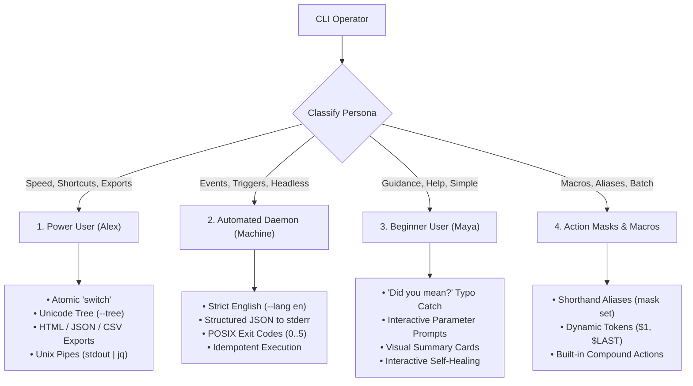

# CLI Architecture & Subsystem Specification

## oXyFlow — Native & Web Command-Line Interface

### 🎯 Vision

The oXyFlow CLI provides a high-velocity, deterministic, and scriptable interface to the time tracking engine. It is designed to serve both human operators (from keyboard-driven power users to terminal beginners) and automated headless daemons (CI/CD pipelines, Git hooks, cron schedulers).

The CLI is built around **strict architectural decoupling**: it lives as an isolated Rust module that directly consumes core domain contracts (`Engine`, `Persistence`), strictly isolated from the Tauri desktop GUI windowing runtime.

---

## 🏛 System Architecture & Modular Isolation

### Dual-Runtime Architectural Topology

```text
                  ┌───────────────────────────────────────────────┐
                  │                 ENTRY POINTS                  │
                  └───────┬───────────────────────────────┬───────┘
                          │                               │
        ┌─────────────────▼───────────────┐     ┌─────────▼─────────────────────┐
        │       Native Shell / CI         │     │     React Desktop / Web       │
        │   (Terminal / Bash / Cmd)       │     │   (CliInterface.tsx Shell)    │
        └─────────────────┬───────────────┘     └─────────┬─────────────────────┘
                          │                               │
                          ▼                               ▼
                 Native Rust CLI Module           TypeScript CliEngine
               (src-tauri/src/cli/*)           (src/features/cli/*)
                          │                               │
        ══════════════════╪═══════════════════════════════╪══════════════════  Module Boundary
                          │                               │
        ┌─────────────────▼───────────────┐     ┌─────────▼─────────────────────┐
        │      Engine & Persistence       │     │    Engine & Persistence       │
        │   (Rust Core Domain Engine)     │     │      (Browser Plugins)        │
        └─────────────────┬───────────────┘     └─────────┬─────────────────────┘
                          │                               │
                          ▼                               ▼
                   SQLite Database               Browser LocalStorage
                   & CSV/API Sinks                   & Web Sinks
```

### Module Isolation Invariants

1. **Zero Tauri GUI Coupling:** The Rust CLI module (`src-tauri/src/cli/`) must NEVER import `AppState`, `tauri::AppHandle`, `tauri::WebviewWindow`, `tauri::Manager`, or UI tray controllers. It must remain purely headless.
2. **Direct Domain Contract Invocation:** The CLI interacts with the application exclusively through:
   - `oxy_flow::engine::Engine` (timers, metrics calculation, temporal validation)
   - `oxy_flow::persistence::Persistence` (repositories: projects, tasks, subtasks, config, holidays, patches)
3. **Library & Workspace Decoupling Roadmap:** The CLI is structured so it can cleanly transition into a standalone crate/library:

   ```text
   Future Cargo Workspace:
   ├── crates/oxy-engine          # Core timer logic, validation, temporal algorithms (lib)
   ├── crates/oxy-persistence     # SQLite repositories, schema, migrations (lib)
   ├── crates/oxy-sinks           # CSV sink, webhook dispatcher, export serializers (lib)
   ├── crates/oxy-cli             # Command parser, formatters, interactive prompts (lib + bin)
   ├── crates/oxy-tray            # Desktop tray icon, native notifications (lib)
   └── src-tauri                  # Tauri wrapper, IPC commands, window orchestration (bin)
   ```

4. **Dual-Runtime Parity:** Every command, argument, flag, error code, and status output has a 1-to-1 parity contract between the Native Rust CLI binary and the In-App Web Terminal Emulator (`src/features/cli/`).

---

## 👥 The Four Persona Models



### 1. The Power User (Alex — Keyboard Maestro)

- **Primary Goal:** Sub-second time tracking without touching the mouse, terminal reports with Unicode trees, instant export for invoices/clients in HTML, JSON and CSV (XML, ODS and XLSX are planned).
- **Key Commands:** `oxy switch <id>`, `oxy report --tree --week`, `oxy report export -f html -o ./rep.html`, `oxy report -f json | jq .`.

### 2. The Automated System / Daemon (Machine / CI / Git Hooks)

- **Primary Goal:** Headless event triggers, deterministic non-interactive execution, zero ambiguity.
- **Strict Invariant:** Always outputs in **English** (`en`), even if the user has configured Polish (`pl`), German (`de`), or Spanish (`es`) in the desktop GUI.
- **Key Commands:** `oxy timer start <id> --machine --json`, `oxy status --machine --json`.
- **Stream Discipline:** Clean data to `stdout`, structured JSON errors to `stderr`, non-zero POSIX exit codes (`1`..`5`).

### 3. The Beginner User (Maya — Junior Developer)

- **Primary Goal:** Zero frustration, welcoming feedback, clear daily summary, smart guidance when mistakes happen.
- **Features:** Fuzzy Levenshtein typo suggestion ("Did you mean?"), interactive prompts when parameters are omitted in TTY mode, friendly summary cards (`oxy summary`), interactive self-healing.

### 4. Action Masks & Macros (Productivity Supercharger)

- **Primary Goal:** Eliminate repetitive typing by binding custom aliases and parameterized command sequences.
- **Features:** `oxy mask set <name> "<template>"`, positional variable injection (`$1`, `$2`, `$LAST_TASK`), built-in compound actions (`switch`, `wrap-up`).

---

## 📋 Typical Actions Lifecycle Matrix

All commands follow the unified canonical hierarchy: `oxy <domain> <action> [args] [flags]`, with top-level shortcuts for primary daily tasks (`start`, `stop`, `switch`, `status`, `today` / `summary`). The `wrap-up` compound action is planned.

> The matrix below describes the target command design. The authoritative list of implemented commands and flags is the clap parser in `src-tauri/src/cli/parser/` (`oxy --help`).

| Domain | Action | Command Syntax | Power User / Machine Flag | Beginner Interactive Behavior |
| :--- | :--- | :--- | :--- | :--- |
| **Project** | Create | `oxy project create "<name>" [-c <color>]` | `--machine --json` | Prompts for project name and color |
| **Project** | Archive | `oxy project archive <id>` | Soft-archives with `archived = true` | Displays confirmation with affected tasks |
| **Project** | List | `oxy project list` | Tabular or JSON output | Color-coded badges and active task counts |
| **Project** | Rename | `oxy project rename <id> "<new-name>"` | Updates entity and audit trail | Prompts for new name |
| **Task** | Create | `oxy task create -p <project-id> "<name>"` | Instant return with generated ID | Prompts to pick project and enter title |
| **Task** | Archive | `oxy task archive <id> -p <project-id>` | Soft-archives task and subtasks | Asks confirmation |
| **Task** | Complete | `oxy task complete <id>` | Toggles `completed: true` | Prints celebratory checkmark |
| **Task** | List | `oxy task list [-p <project-id>]` | Supports filtering and sorting | Hierarchical list with subtasks |
| **Subtask** | Create | `oxy subtask create -t <parent-id> "<name>"` | Links subtask to parent | Prompts for parent task selection |
| **Timer** | Start | `oxy timer start <task-id>` | Starts active log in SQLite | Displays green running timer badge |
| **Timer** | Stop | `oxy timer stop [--all]` | Idempotent timer stop | Prints total elapsed time for session |
| **Timer** | Switch | `oxy switch <new-task-id>` | Atomic stop old + start new ($<100\text{ms}$) | Explains previous and new task state |
| **Timer** | Quick-Log | `oxy timer log <task-id> <duration> ["<note>"]` | Direct retroactive log insertion | Confirms retroactive time captured |
| **Timer** | Status | `oxy status` | Single-line or JSON status | Visual card with live running timer |
| **Report** | Tree | `oxy report --tree [--today\|--week\|--month]` | Unicode box-drawing with bars | Easy-to-read hierarchy |
| **Report** | Summary | `oxy summary` | JSON in machine mode | Humanized daily card with praise |
| **Report** | Export | `oxy report export -f <format> -o <path>` | Supports **HTML, JSON, CSV**; `xml`, `ods`, `xlsx` are accepted by the parser but rejected with exit code `2` until implemented | Interactive format selector |
| **Report** | Stream | `oxy report -f json \| jq .` | Raw unescaped JSON to `stdout` | N/A (interactive terminal) |
| **Sink** | Set CSV | `oxy sink set csv --dir <path>` | Configures local CSV audit log | Prompts for directory path |
| **Sink** | Set API | `oxy sink set webhook --url <url> -t <token>` | Updates external webhook target | Tests connectivity and saves |
| **Sink** | Test | `oxy sink test` | Synthetic event verification | Displays green checkmarks for active sinks |
| **Mask** | Set | `oxy mask set <name> "<template>"` | Saves alias in SQLite `cli_aliases` | Validates syntax and explains variables |
| **Mask** | List | `oxy mask list` | Lists registered aliases | Displays examples of how to run them |

---

## 🛡️ Hierarchical Error & Failure Architecture

The CLI enforces a **Dual-Layer Response Architecture**:

```text
┌────────────────────────────────────────────────────────────────────────┐
│                        CLI RESPONSE ENVELOPE                           │
├────────────────────────────────────────────────────────────────────────┤
│  TECHNICAL LAYER (ALWAYS ENGLISH — GUARANTEED STABLE):                 │
│    • code: "DOM_ENTITY_NOT_FOUND"                                      │
│    • category: "entity"                                                │
│    • technical: "Task with ID '104' was not found in active project."  │
│    • exit_code: 4                                                      │
│    • timestamp: "2026-10-18T11:42:01.402Z"                             │
├────────────────────────────────────────────────────────────────────────┤
│  USER INFORMATION LAYER (CHOSEN LANGUAGE — e.g. POLISH 'pl'):          │
│    • locale: "pl"                                                      │
│    • message: "Zadanie o numerze '104' nie istnieje w projekcie."      │
│    • suggestion: "Czy chodziło Ci o zadanie #105 'OAuth2 Auth'?"       │
│    • remediation: "Użyj 'oxy task list', aby wyświetlić listę zadań."  │
└────────────────────────────────────────────────────────────────────────┘
```

The envelope is `CliErrorEnvelope` in `src-tauri/src/cli/error/envelope.rs`; the user layer (`LocalizedUserMessage`) is optional and omitted in `--machine` mode.

### Exit Codes

Defined in `src-tauri/src/cli/shared/constants.rs` and mapped by `CliError::exit_code()`:

| Exit Code | Meaning |
| :--- | :--- |
| `0` | Success |
| `1` | Business rule violation |
| `2` | Invalid syntax or arguments |
| `3` | Storage (SQLite) failure |
| `4` | Entity not found, ambiguous or did-you-mean |
| `5` | Engine / timer lifecycle conflict |

### Semantic Error Codes

Defined in `src-tauri/src/cli/error/codes.rs`. Codes marked *not yet emitted* exist in the enum but no code path produces them yet.

| Category | Semantic Code | Exit Code | Description (Always English) |
| :--- | :--- | :--- | :--- |
| `syntax` | `CLI_SYNTAX_INVALID_ARGS` | `2` | Invalid arguments |
| `syntax` | `CLI_SYNTAX_INVALID_DURATION` | `2` | Duration could not be parsed |
| `syntax` | `CLI_SYNTAX_EMPTY_ID` | `2` | Empty entity ID |
| `syntax` | `CLI_SYNTAX_MISSING_TARGET` | `2` | Required target missing |
| `syntax` | `CLI_SYNTAX_UNKNOWN_COMMAND` | `2` | Unknown command |
| `entity` | `DOM_ENTITY_NOT_FOUND` | `4` | Target project, task or subtask not found |
| `entity` | `DOM_ENTITY_AMBIGUOUS` | `4` | Query matches more than one entity |
| `entity` | `DOM_ENTITY_DID_YOU_MEAN` | `4` | No exact match; close matches suggested |
| `storage` | `STO_SQLITE_INIT` | `3` | Database initialization failed |
| `storage` | `STO_SQLITE_QUERY` | `3` | Query failed |
| `storage` | `STO_SQLITE_CONSTRAINT` | `3` | Constraint violation |
| `engine` | `ENG_TIMER_CONFLICT` | `5` | Active timer conflict |
| `engine` | `ENG_TIMER_ACTIVE` | `5` | Timer already active (*not yet emitted*) |
| `engine` | `ENG_TIMER_INACTIVE` | `5` | No active timer running |
| `business` | `DOM_BUSINESS_VIOLATION` | `1` | Business rule violated |
| `business` | `DOM_BUSINESS_NO_PROJECTS` | `1` | Operation requires at least one project |
| `sink` | `SNK_EXTERNAL_IO` | `1` | Sink I/O failure (*not yet emitted*) |
| `mask` | `MSK_ALIAS_NOT_FOUND` | `2` | Action mask alias not found |
| `mask` | `MSK_ALIAS_SYNTAX` | `2` | Invalid mask template (*not yet emitted*) |

### Interactive Self-Healing in TTY

In interactive human terminal mode, encountering an unknown entity or a missing required argument does not abort the shell. Instead, the prompter:

1. Calculates Levenshtein distances ($\le 2$) against known entity names/commands.
2. Displays the nearest matches in the user's localized language.
3. Offers an interactive selector to pick the intended entity or create it on the spot.

---

## 🪟 In-App Global CLI Drawer & Session Synchronization

### 1. CliDrawer Architecture (``Ctrl+` `` / `Esc`)

The in-app CLI is accessible everywhere across all application layouts (Compact, Medium, Full) via the global `CliDrawer` component (`src/features/cli/CliDrawer.tsx`):

- **Slide-Down Presentation**: Animated top sheet (`motion.div`) with polymorphic design tokens (`bg-card/95`, `backdrop-blur-xl`, `border-border`, `text-foreground`).
- **Global Keybinding**: Toggled instantaneously via ``Ctrl+` `` (`Backquote`), registered via `useGlobalShortcuts`.
- **Keyboard Trapping & Dismissal**: Automatically closes on `Escape` or clicking the backdrop overlay/close button, restoring focus to the primary UI.
- **Responsive Layout Adaptation**: When toggled in `CompactLayout`, `CliSessionProvider` automatically expands the window into `MediumLayout` so the terminal console has sufficient viewport space without clipping.

### 2. CliSessionContext & State Synchronization

Terminal history, execution state, and command buffers are orchestrated by `CliSessionContext` (`src/features/cli/context/CliSessionContext.ts` and `CliSessionProvider.tsx`):

- **Shared Session**: Commands executed in `CliDrawer` immediately reflect in `CliInterface.tsx` and vice-versa.
- **Command History Navigation**: Preserves arrow up/down history traversal with synchronous cursor management (`historyIndexRef` + state) to prevent race conditions during input editing.
- **Polymorphic Execution**: Commands run through `executeCliCommand(cmd, context)`, supporting both live business operations (`DataContext`) and safe sandbox emulation.

### 3. Business Mode vs Sandbox Emulator Mode

The CLI supports a dedicated in-memory sandbox emulator (`src/features/cli/sandbox/`):

- **Live Engine Mode**: Active by default (indicated by `[LIVE ENGINE]` emerald badge). Commands write directly to the persistent SQLite database / DataContext.
- **Sandbox Emulator Mode**: Toggled via `sandbox on` / `sandbox off` / `sandbox reset` (indicated by `[SANDBOX EMULATOR]` amber badge).
  - All operations (`addproject`, `addtask`, `start`, `stop`, `switch`) execute in memory inside `SandboxEmulatorStore`.
  - Zero persistence side-effects: Production SQLite / LocalStorage data remains completely untouched.
  - Realistic Demo Fixtures: Pre-populated with realistic tasks, subtasks, and logs from `sandboxDemoData.ts`.
  - Realistic Metrics: Calculated via `sandboxMetricsCalculator.ts`.

### 4. Atomic `switch` Command & Language Disciplines

- **Atomic Task Switching**: `switch <target-task-id>` stops any currently active timer and starts the new timer in a single transaction, eliminating race conditions or manual multi-step stop/start actions.
- **Language Disciplines**:
  - Command outputs (`stdout` / success logs / tabular summaries) are **strictly English** to ensure deterministic parsing, copy-pasting, and scripting.
  - Interactive help (`help`), usage tips, error diagnoses, and remediation advice adapt to the active user locale dictionary (`en`, `pl`, `de`, `es`, `fr`, `pt-br`).

---

## 🧪 Testing Architecture & Segregation

CLI tests are kept in dedicated directories (structure and naming rules: [`testing_standards.md`](../.agents/rules/testing_standards.md)):

```text
TimeLog/
├── src-tauri/tests/
│   ├── unit/cli/                        # Rust CLI unit tests
│   │   ├── parser_test.rs               # Syntax and flag parsing
│   │   ├── duration_parser_test.rs      # Duration parsing
│   │   ├── error_test.rs                # Error envelopes and exit codes
│   │   ├── levenshtein_test.rs          # Typo distance
│   │   ├── resolver_test.rs             # Entity resolution
│   │   ├── prompter_test.rs             # Interactive prompts
│   │   ├── tree_renderer_test.rs        # Unicode tree formatting
│   │   ├── exporter_test.rs             # HTML / CSV / JSON exports
│   │   └── dashboard_test.rs            # Summary output
│   └── integration/cli/                 # Rust CLI integration tests (real SQLite in temp dirs)
│       ├── cli_test.rs, cli_subtask_test.rs, cli_settings_test.rs
│       ├── ergonomic_flow_test.rs, interactive_flow_test.rs, subsystem_flow_test.rs
│       ├── report_integration_test.rs, error_envelope_test.rs
│       ├── cli_parity_test.rs           # Shared parity fixtures (Rust side)
│       └── subprocess_test.rs           # Compiled binary execution
└── tests/
    ├── unit/features/cli/               # In-app CLI unit tests (CliDrawer, CliInterface, context, sandbox, utils)
    ├── integration/cli/
    │   ├── cli-cross-runtime-parity.test.ts   # Shared parity fixtures (TS side)
    │   ├── cli-drawer-integration.test.tsx
    │   └── cli-interface.test.tsx
    └── shared/fixtures/cli-parity-cases.json  # Parity matrix used by both runtimes
```

---

## 🔗 Related Documentation

- [`MASTERMAP.md`](./MASTERMAP.md) — Product roadmap and phase tracking.
- [`ENGINEERING.md`](./ENGINEERING.md) — Architectural invariants and coding standards.
- [`USERINTERFACE.md`](./USERINTERFACE.md) — Spatial composition and design tokens.
- [`USEREXPERIENCE.md`](./USEREXPERIENCE.md) — UX workflows and feedback paradigms.
