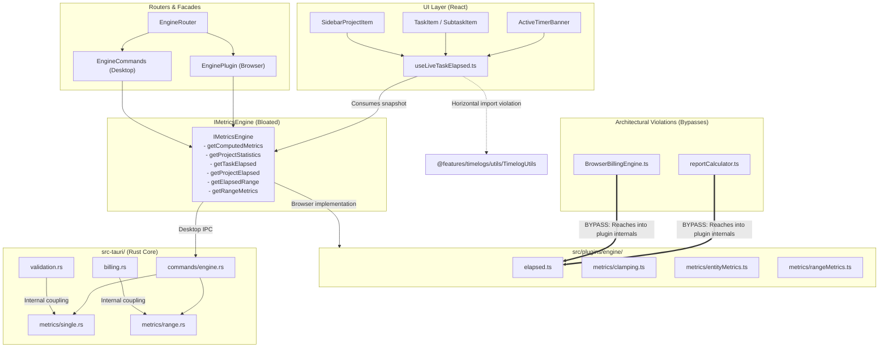
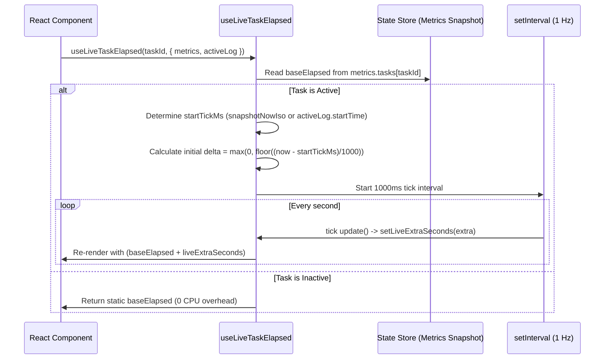
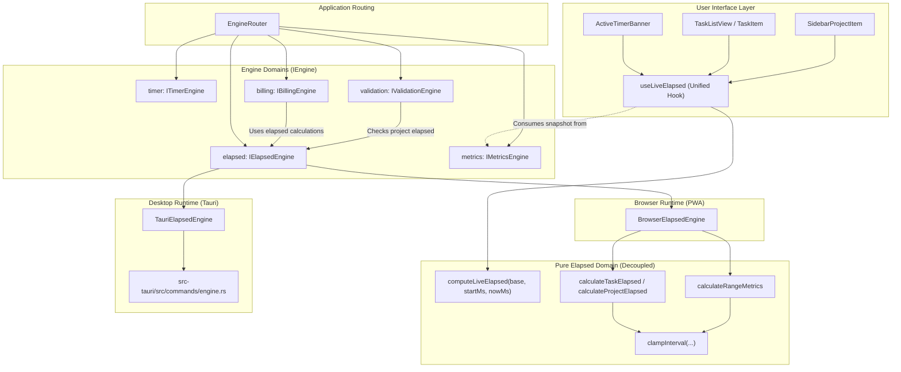

# ELAPSED_DOMAIN_ANALYSIS.md

## Elapsed Domain Architectural Analysis & Decomposition Manifesto

This document provides a comprehensive architectural analysis of the **Elapsed** domain within oXyFlow TimeLog. It establishes the theoretical and practical foundation for extracting Elapsed into an independent, first-class engine domain (Task 2: `elapsed-domain-extraction`), decoupling duration calculation from timer lifecycle state, reporting telemetry, and UI rendering hooks.

---

## 1. Executive Summary & Context

### 1.1 The Core Problem
In the current architecture, duration calculation (**Elapsed**) is dispersed across multiple layers:
- Intermixed within `IMetricsEngine` alongside aggregated reporting metrics (`EngineComputedMetrics`, `ProjectStatistics`).
- Directly imported across boundaries by feature utilities (e.g., `reportCalculator.ts` importing directly from `@plugins/engine/elapsed`).
- Implemented as live-ticking state logic inside React hooks (`useLiveTaskElapsed`, `useLiveProjectElapsed`) coupled to UI presentation utilities.
- Implemented in parallel across TypeScript (`BrowserMetricsEngine`, `src/plugins/engine/metrics/`) and Rust (`src-tauri/src/engine/metrics/`).

### 1.2 Architectural Principle: Separation of Timer, Elapsed, and Metrics
A recurring source of architectural friction is the conflation of three distinct concepts:

| Domain Concept | Core Responsibility | State Characteristic | Temporal Mutability |
| :--- | :--- | :--- | :--- |
| **Timer** (`ITimerEngine`) | Lifecycle transitions: start, stop, resume, switch timer; identify active logs. | Stateful, mutates persistence, controls running session. | Discrete event boundaries (`startTime`, `endTime = null`). |
| **Elapsed** (`IElapsedEngine`) | Temporal interval evaluation: calculates precise duration (in seconds) of tasks, projects, and arbitrary clamped ranges. | Pure calculation or query-level computation across logs. | Continuous evaluation against a reference point ($now$). |
| **Metrics** (`IMetricsEngine`) | Aggregation and telemetry: dashboard KPI snapshots, today/week counters, completion ratios, project health statistics. | Composite data structures, caching, index maps. | Snapshot-bound, structured data models. |

**Elapsed is not an internal implementation detail of Timer, nor is it merely a subset of Metrics.** It is a standalone temporal query domain required by validation, billing, reporting, and real-time UI counters.

---

## 2. Current Codebase Inventory & Distribution

The following inventory identifies all occurrences of Elapsed logic across the TypeScript and Rust codebases.

### 2.1 Interface & Router Layer (TypeScript)

| File Path | Component / Symbol | Current Responsibilities & Elapsed Methods |
| :--- | :--- | :--- |
| `src/common/engine/IEngine.ts` | `IMetricsEngine` | Declares `getTaskElapsed`, `getProjectElapsed`, `getElapsedRange`, and `getRangeMetrics` alongside `getComputedMetrics` and `getProjectStatistics`. |
| `src/common/engine/IEngine.ts` | `IEngine` | Root engine interface exposing `timer`, `metrics`, `timeLogs`, `validation`, and `billing`. Missing `elapsed`. |
| `src/common/engine/EngineRouter.ts` | `EngineRouter` | Singleton router delegating `get metrics(): IMetricsEngine` to `EngineCommands` (desktop) or `EnginePlugin` (browser). |
| `src/common/engine/EngineCommands.ts` | `EngineCommands` | Desktop facade implementing `IEngine`; delegates `getTaskElapsed`, `getProjectElapsed`, and `getElapsedRange` to `this.metrics`. |
| `src/plugins/engine/EnginePlugin.ts` | `EnginePlugin` | Browser PWA facade implementing `IEngine`; delegates `getTaskElapsed`, `getProjectElapsed`, and `getElapsedRange` to `this.metrics`. |

### 2.2 TypeScript Runtime Implementations

| File Path | Component / Symbol | Implementation Details |
| :--- | :--- | :--- |
| `src/common/engine/commands/TauriMetricsEngine.ts` | `TauriMetricsEngine` | Desktop runtime invoking Tauri IPC commands: `get_task_elapsed`, `get_project_elapsed`, `get_elapsed_range`, `get_range_metrics`. |
| `src/plugins/engine/services/BrowserMetricsEngine.ts` | `BrowserMetricsEngine` | Browser runtime querying `PersistenceRouter.core.load()` and delegating to pure calculation functions. |
| `src/plugins/engine/metrics/clamping.ts` | `clampInterval` | Pure algorithm clamping interval `[startTime, endTime]` to `[rangeStart, rangeEnd]`, calculating `clampedDurationSeconds` and multi-day segment flags. |
| `src/plugins/engine/metrics/entityMetrics.ts` | `calculateTaskElapsed`, `calculateProjectElapsed` | Pure recursive functions summing task durations and child subtasks; project totals sum all root tasks. |
| `src/plugins/engine/metrics/rangeMetrics.ts` | `calculateRangeMetrics`, `calculateElapsedRange` | Pure algorithm evaluating clamped logs and patches across task trees and project filters within arbitrary time windows. |
| `src/plugins/engine/metrics/computedMetrics.ts` | `computeAllMetrics`, `aggregateLogMetrics` | Aggregates log metrics including today/week overlap intervals and running states into `EngineComputedMetrics`. |
| `src/plugins/engine/elapsed.ts` | Barrel Module | Re-exports clamping and calculation functions from `metrics/` to external consumers. |

### 2.3 Rust Reference Engine (`src-tauri/`)

| File Path | Component / Symbol | Implementation Details |
| :--- | :--- | :--- |
| `src-tauri/src/commands/engine.rs` | Tauri Command Handlers | `get_task_elapsed`, `get_project_elapsed`, `get_elapsed_range`, `get_range_metrics`. Invokes methods on `Engine`. |
| `src-tauri/src/app/builder.rs` | Builder Registration | Registers IPC command handlers in Tauri's `generate_handler!`. |
| `src-tauri/src/engine/metrics/single.rs` | `Engine::calculate_task_elapsed`, `calculate_project_elapsed` | Reads logs from `persistence.time_logs.get_for_task`, recursively queries subtasks, and computes `Duration`. |
| `src-tauri/src/engine/metrics/single.rs` | `Engine::calculate_log_elapsed` | Parses start/end RFC 3339 timestamps and evaluates single log elapsed duration. |
| `src-tauri/src/engine/metrics/range.rs` | `Engine::calculate_elapsed_range`, `calculate_range_metrics` | Clamps all stored time logs (and optional patches) against an `ElapsedRangeFilter`, producing `RangeMetricsResult`. |
| `src-tauri/src/engine/metrics/clamping.rs` | `clamp_interval` | Native Rust implementation of interval clamping matching browser logic. |
| `src-tauri/src/engine/metrics/computed.rs` | `LogAggregates::compute` | Aggregates task and project durations, including running states and day/week window overlaps. |
| `src-tauri/src/engine/validation.rs` | `validate_project_deletion` | Invokes `self.calculate_project_elapsed(project_id)?` to verify that a project has zero accumulated time prior to deletion. |
| `src-tauri/src/engine/billing.rs` | `calculate_range_billing` | Invokes `self.calculate_range_metrics(filter, now_iso)?` to retrieve per-task elapsed seconds for billable calculations. |

### 2.4 UI Live Presentation Layer

| File Path | Component / Symbol | Responsibilities & Observed Coupling |
| :--- | :--- | :--- |
| `src/common/hooks/useLiveTaskElapsed.ts` | `useLiveTaskElapsed` | React hook maintaining dynamic interval ticker (`setInterval`), computing $elapsed = baseElapsed + \Delta(now - startTick)$, and formatting via `formatSeconds`. |
| `src/common/hooks/useLiveTaskElapsed.ts` | `useLiveProjectElapsed` | Duplicate live ticker hook for project entities based on `metrics.projects[id].totalElapsedSeconds`. |
| `src/features/tasks/components/TaskItem/SubtaskItem.tsx` | Subtask Item UI | Calls `useLiveTaskElapsed(subTask.id, ...)` to show running badge and time counter. |
| `src/features/tasks/components/TaskItem/hooks/useTaskItem.ts` | Task Item Hook | Calls `useLiveTaskElapsed(rootTask.id, ...)` to track parent task elapsed and running state. |
| `src/features/tasks/hooks/useProjectStatistics.ts` | Project Stats Hook | Calls `useLiveProjectElapsed(projectId, ...)` to maintain real-time project header duration. |
| `src/layouts/parts/ActiveTimerBanner.tsx` | Timer Banner UI | Calls `useLiveTaskElapsed` for both active and previous tasks to display running clocks. |
| `src/layouts/parts/MediumProjectSelector.tsx` | Project Selector UI | Calls `useLiveProjectElapsed` to display live project running times. |
| `src/layouts/parts/sidebar/SidebarProjectItem.tsx` | Sidebar Project Item | Calls `useLiveProjectElapsed` to render live timer badges next to project names. |

### 2.5 Cross-Domain Bypasses & Direct Coupling



---

## 3. Data Flow & Execution Pathways

### 3.1 Point-in-Time Elapsed Query (`getTaskElapsed` / `getProjectElapsed`)

When a consumer queries the accumulated time of an entity at a given instant:
1. **Consumer Call**: Invokes `EngineRouter.getInstance().metrics.getTaskElapsed(taskId, nowIso)`.
2. **Desktop Pathway (Tauri)**:
   - `EngineCommands` delegates to `TauriMetricsEngine`.
   - `TauriMetricsEngine` invokes Tauri command `get_task_elapsed`.
   - Tauri command handler calls `Engine::calculate_task_elapsed`.
   - `calculate_task_elapsed` reads all logs for the task, calculates closed logs and active logs using `Utc::now()`, then queries child subtasks from persistence and recursively sums their durations.
   - Result is returned across IPC as raw seconds (`u64` $\to$ `number`).
3. **Browser Pathway (PWA / Emulator)**:
   - `EnginePlugin` delegates to `BrowserMetricsEngine`.
   - `BrowserMetricsEngine` loads core state snapshot (`tasks`, `logs`, `projects`) from `PersistenceRouter`.
   - Calls pure function `calculateTaskElapsed(taskId, tasks, logs, nowIso)`.
   - Sums task intervals and recursively sums child task intervals in memory.
   - Returns total elapsed seconds (`number`).

### 3.2 Live UI Dynamic Ticking Flow (`useLiveTaskElapsed`)



---

## 4. Problem Identification & Architectural Violations

### 4.1 Violation of Single Responsibility Principle (SRP) in `IMetricsEngine`
`IMetricsEngine` currently serves two divergent concerns:
1. **Scalar Temporal Calculations**: Measuring raw seconds for individual entities or window-clamped intervals (`getTaskElapsed`, `getProjectElapsed`, `getElapsedRange`, `getRangeMetrics`).
2. **Composite Metric Aggregations**: Computing high-level analytics, dashboard counters, task progress counts, and project statistics (`getComputedMetrics`, `getProjectStatistics`).

Consumers needing simple elapsed calculations (such as project deletion validation or billing rate multiplication) are forced to depend on the entire metrics surface.

### 4.2 Architectural Layer Bypasses
- **`reportCalculator.ts`**: Skips the `EngineRouter` / `IEngine` abstraction entirely and imports `calculateRangeMetrics` directly from `@plugins/engine/elapsed`. This creates a tight coupling to the browser engine implementation and prevents the desktop runtime from executing report range calculations natively via Rust IPC when running in Tauri.
- **`BrowserBillingEngine.ts`**: Imports `calculateRangeMetrics` directly from `../elapsed` instead of accessing the engine contract through composition.

### 4.3 Domain Logic Leakage into Presentation Layer
`src/common/hooks/useLiveTaskElapsed.ts` contains core temporal math:
- Computing elapsed delta from millisecond timestamps.
- Negative interval sanitization (`Math.max(0, ...)`).
- Fallback arbitration between snapshot timestamps and active log start times.

Because this logic is embedded within a React hook, it cannot be reused in non-React contexts (CLI utilities, background workers, node automation scripts) without mocking React hook lifecycles. Furthermore, `useLiveTaskElapsed.ts` imports `formatSeconds` from `@/src/features/timelogs/utils/TimelogUtils`, violating the architectural boundary that prohibits `@common` modules from importing from `@features`.

### 4.4 Duplication in Live Hooks
`useLiveTaskElapsed` and `useLiveProjectElapsed` contain duplicate implementations of the tick calculation, `resolveStartTickMs`, `setInterval` lifecycle, and state delta tracking. Only the selector extracting the base duration differs.

### 4.5 Asymmetry and Temporal Invariance in Rust IPC Handlers
In `src-tauri/src/commands/engine.rs`:
```rust
#[tauri::command]
pub fn get_task_elapsed(
    task_id: String,
    _now_iso: Option<String>,
    state: State<'_, AppState>,
) -> Result<u64, AppError> {
    let engine = Engine::new(&state.persistence);
    let duration = engine.calculate_task_elapsed(&task_id)?;
    Ok(duration.as_secs())
}
```
The parameter `_now_iso` is ignored in `get_task_elapsed`, `get_project_elapsed`, and `get_elapsed_range`. The Rust engine always falls back to `Utc::now()`. In contrast, the browser implementation and Rust's `calculate_range_metrics` honor `now_iso`. This asymmetry prevents deterministic time-travel testing and synchronized frame evaluation across runtimes.

### 4.6 Performance Inefficiencies in Rust Reference Implementation
In `src-tauri/src/engine/metrics/single.rs`, `calculate_task_elapsed` performs an independent SQLite read query for every subtask node in the task tree:
```rust
let subtasks = self.persistence.tasks.get_subtasks(task_id)?;
for subtask in subtasks {
    total_duration += self.calculate_subtask_elapsed(&subtask.id)?;
}
```
For deep task hierarchies, this results in an $O(N)$ query cascade (N+1 database queries). In contrast, `calculate_range_metrics` loads all logs once and builds an in-memory index.

---

## 5. Domain Decomposition & Target Architecture (Task 2 Blueprint)

To resolve the identified violations while preserving strict backward compatibility and cross-runtime parity, the Elapsed domain must be extracted into a dedicated sub-engine: `IElapsedEngine`.

### 5.1 Proposed Interface Contract: `IElapsedEngine`

```typescript
// Proposed path: src/common/engine/elapsed/types.ts or within IEngine.ts
import { ElapsedRangeFilter } from '@bindings/ElapsedRangeFilter';
import { RangeMetricsResult } from '@bindings/RangeMetricsResult';

export interface IElapsedEngine {
  /**
   * Calculates total elapsed duration (in seconds) for a task and all its subtasks.
   * If nowIso is provided, active logs evaluate against that reference time.
   */
  getTaskElapsed(taskId: string, nowIso?: string): Promise<number>;

  /**
   * Calculates total elapsed duration (in seconds) for all root tasks in a project.
   */
  getProjectElapsed(projectId: string, nowIso?: string): Promise<number>;

  /**
   * Calculates total elapsed duration (in seconds) within a clamped time window.
   */
  getElapsedRange(range: ElapsedRangeFilter, nowIso?: string): Promise<number>;

  /**
   * Evaluates comprehensive range metrics, returning clamped segment durations,
   * per-project totals, per-task totals, and clamped log details.
   */
  getRangeMetrics(range: ElapsedRangeFilter, nowIso?: string): Promise<RangeMetricsResult>;
}
```

### 5.2 Refined Engine Architecture (`IEngine`)

```typescript
export interface IEngine {
  readonly timer: ITimerEngine;
  readonly elapsed: IElapsedEngine;
  readonly metrics: IMetricsEngine;
  readonly timeLogs: ITimeLogsEngine;
  readonly validation: IValidationEngine;
  readonly billing: IBillingEngine;
}
```

### 5.3 Responsibility Division: `IElapsedEngine` vs `IMetricsEngine`

| Method / Responsibility | Target Domain | Rationale |
| :--- | :--- | :--- |
| `getTaskElapsed(taskId, nowIso)` | `IElapsedEngine` | Pure temporal duration measurement of a specific entity. |
| `getProjectElapsed(projectId, nowIso)` | `IElapsedEngine` | Pure temporal duration measurement of an entire project hierarchy. |
| `getElapsedRange(range, nowIso)` | `IElapsedEngine` | Scalar duration of clamped intervals within a temporal window. |
| `getRangeMetrics(range, nowIso)` | `IElapsedEngine` | Detailed temporal segment clamping and interval breakdown. |
| `getComputedMetrics(nowIso)` | `IMetricsEngine` | High-level system snapshot containing precomputed state, today/week counters, and running statuses. |
| `getProjectStatistics(projectId)` | `IMetricsEngine` | Business summary including total task counts, completed counts, and aggregated ratios. |

### 5.4 Target Architecture Diagram



---

## 6. Implementation Strategy for Task 2 (`elapsed-domain-extraction`)

The extraction in Task 2 should execute according to the following phased roadmap:

### Phase 1: Contract & Router Definition
1. Create `src/common/engine/elapsed/types.ts` defining `IElapsedEngine`.
2. Add `readonly elapsed: IElapsedEngine` to `IEngine`.
3. In `IMetricsEngine`, retain `getTaskElapsed`, `getProjectElapsed`, `getElapsedRange`, and `getRangeMetrics` as deprecated methods that delegate directly to `IElapsedEngine` to prevent breaking existing consumers during the migration.
4. Expose `get elapsed(): IElapsedEngine` on `EngineRouter`.

### Phase 2: Runtime Engine Implementations
1. **Desktop**: Create `src/common/engine/commands/TauriElapsedEngine.ts` implementing `IElapsedEngine` via existing Tauri IPC calls (`get_task_elapsed`, `get_project_elapsed`, `get_elapsed_range`, `get_range_metrics`).
2. **Browser**: Create `src/plugins/engine/services/BrowserElapsedEngine.ts` implementing `IElapsedEngine`.
3. Wire `TauriElapsedEngine` into `EngineCommands` and `BrowserElapsedEngine` into `EnginePlugin`.

### Phase 3: Pure Temporal Calculation Consolidation
1. Consolidate pure temporal algorithms from `src/plugins/engine/metrics/` into an agnostic common location or dedicated elapsed domain module (e.g., `@common/engine/elapsed/`).
2. Refactor `reportCalculator.ts` to use `calculateRangeMetrics` through the canonical engine or decoupled calculation utilities without bypassing runtime abstractions.
3. Decouple `BrowserBillingEngine` to rely on `IElapsedEngine` rather than direct file imports from `../elapsed`.

### Phase 4: UI Hook Refactoring & Layer Purity
1. Extract pure live delta arithmetic from `src/common/hooks/useLiveTaskElapsed.ts` into a testable domain utility:
   ```typescript
   export function computeLiveElapsedSeconds(
     baseElapsedSeconds: number,
     startTickMs: number,
     nowMs: number = Date.now()
   ): number {
     const deltaSeconds = Math.max(0, Math.floor((nowMs - startTickMs) / 1000));
     return baseElapsedSeconds + deltaSeconds;
   }
   ```
2. Unify `useLiveTaskElapsed` and `useLiveProjectElapsed` into a shared core hook (`useLiveElapsed`) with entity-specific adapters.
3. Remove the illegal horizontal dependency on `@/src/features/timelogs/utils/TimelogUtils` by passing a custom formatter or moving duration formatting to `@common/utils/time`.

### Phase 5: Rust Reference Engine Polish
1. Fix the parameter omission in `src-tauri/src/commands/engine.rs` so that `now_iso` is passed down to `calculate_task_elapsed` and `calculate_project_elapsed`.
2. Update internal calls in `src-tauri/src/engine/validation.rs` and `src-tauri/src/engine/billing.rs` to clearly reference the elapsed calculation domain.

### Phase 6: Parity & Regression Verification
1. Extend `tests/integration/engine/CrossRuntimeParity.test.ts` to verify full parity across `engine.elapsed.*`.
2. Ensure all existing unit tests in `tests/unit/plugins/engine/elapsed.test.ts` and `tests/unit/common/engine/` pass without modification.
3. Execute `bun run docs:validate` to ensure documentation integrity.

---

## 7. Backward Compatibility Assessment

| Consumer Area | Risk Level | Mitigation Strategy |
| :--- | :--- | :--- |
| **Existing `engine.metrics.getTaskElapsed()` calls** | Zero Risk | Deprecated delegation: `engine.metrics.getTaskElapsed` forwards directly to `engine.elapsed.getTaskElapsed`. |
| **CLI & Commands (`timeCommand`, `reportCommand`)** | Zero Risk | Can migrate to `engine.elapsed` immediately or continue using `engine.metrics` via delegation. |
| **Tauri IPC Command Names** | Zero Risk | IPC endpoint names (`get_task_elapsed`, `get_project_elapsed`, `get_elapsed_range`, `get_range_metrics`) remain unchanged; Rust command handlers remain stable. |
| **Component UI Tests** | Zero Risk | `useLiveTaskElapsed` and `useLiveProjectElapsed` public signatures remain unchanged. |
| **Parity Test Suite** | Low Risk | Additive assertions for `plugin.elapsed.*` and `commands.elapsed.*` without removing existing checks. |

---

## 8. Conclusion

Extracting the **Elapsed** domain from `IMetricsEngine` eliminates single-responsibility violations, clarifies the distinction between timer control and duration calculation, removes illegal horizontal imports, and establishes clean pathways for reports and billing. This analysis serves as the blueprint for Task 2 (`elapsed-domain-extraction`).
